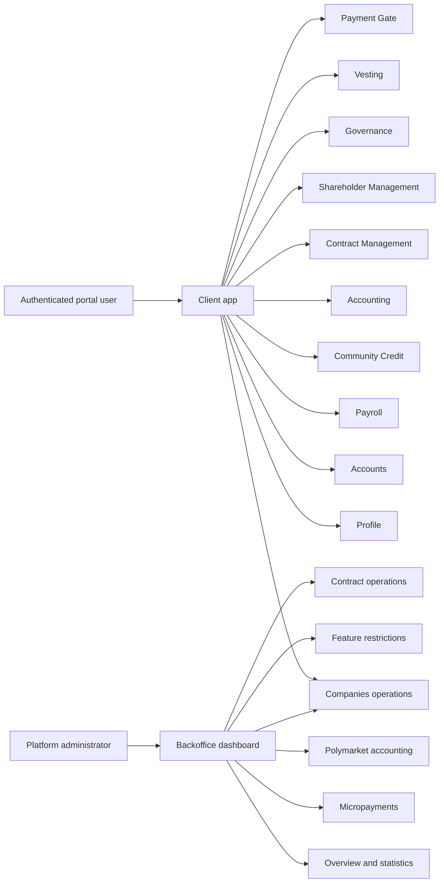

# Product Feature Catalogue

**Status:** Catalogue with a navigation-derived current-access inventory

**Current-access inventory last verified:** 2026-08-28

The current-access inventory below names the product domains that a user can currently reach in the CNC Portal client or its administrator
dashboard. It is derived from the current navigation, routes, access guards, and linked product actions. The presence of a source directory,
API, contract, or standalone route does not make something a product feature.

Documentation coverage is recorded separately from product access. A missing or legacy document does not mean that the corresponding product
surface is absent, and a document does not prove that the feature has passed human review.

## Current Client Modules

The client inventory follows the [Client Navigation implementation](../implementation/client-navigation/README.md) and the authentication
entry journey.

| User capability         | Current entry points                                                    | Documentation coverage                                  |
| ----------------------- | ----------------------------------------------------------------------- | ------------------------------------------------------- |
| Authentication          | `/login` and wallet session actions                                     | [Canonical stories](./authentication/README.md)         |
| Profile                 | Profile action in the client navigation                                 | [Canonical stories](./user-profile/README.md)           |
| Companies and workspace | `/teams`, `/teams/:id`                                                  | [Canonical stories](./companies/README.md)              |
| Accounts                | Bank, Safe, and Expense Account routes                                  | [Canonical stories](./accounts/README.md)               |
| Payroll                 | Payroll account, history, company payroll, compensation                 | [Canonical stories](./payroll/README.md)                |
| Community Credit        | Rounds, new credit calls, and bookmarkable round views                  | [Canonical stories](./community-credit/README.md)       |
| Accounting              | Summary, income, balance, trial balance, ledger, and account assignment | [Canonical stories](./accounting/README.md)             |
| Contract Management     | `/teams/:id/contract-management`                                        | [Canonical stories](./contract-management/README.md)    |
| Shareholder Management  | `/teams/:id/sher-token`                                                 | [Canonical stories](./shareholder-management/README.md) |
| Board elections         | Board-election overview and election details                            | [Canonical stories](./elections/README.md)              |
| Vesting                 | `/teams/:id/vesting`                                                    | [Canonical stories](./vesting/README.md)                |
| Payment Gate            | `/teams/:id/payment-gate`, `/reference`, `/history`                     | [Canonical stories](./payment-gate/README.md)           |

## Current Backoffice Modules

All administrator-dashboard capabilities are grouped under [`docs/features/backoffice/`](./backoffice/README.md). They are not separate
top-level client modules.

| Administrator capability | Current entry points                        | Documentation coverage                                            |
| ------------------------ | ------------------------------------------- | ----------------------------------------------------------------- |
| Overview and statistics  | `/`                                         | [Canonical stories](./backoffice/statistics/README.md)            |
| Companies operations     | `/teams`, `/teams/:id`                      | [Canonical stories](./backoffice/companies-operations/README.md)  |
| Micropayments            | `/micropayments`                            | [Canonical stories](./backoffice/micropayments/README.md)         |
| Polymarket accounting    | `/accounting`                               | [Canonical stories](./backoffice/polymarket-accounting/README.md) |
| Feature restrictions     | `/features`, `/features/:id`                | [Canonical stories](./backoffice/feature-restrictions/README.md)  |
| Contract operations      | `/contracts/history`, `/contracts/versions` | [Canonical stories](./backoffice/contract-operations/README.md)   |

## Excluded from the Product Inventory

- Smart-contract packages and contract-specific documentation describe implementation behaviour under `docs/contracts/`; they are not portal
  features by themselves.
- RBAC and runtime wake-up are architectural capabilities under `docs/implementation/`. Database seeding is development tooling. None is a
  direct user goal.
- Login guards, access-denied pages, error pages, and development playgrounds are journey states or tooling, not standalone features.
- Board Proposals is suspended and not in current product planning. Its page, routes, navigation, and contract-write UI are removed. The
  contract artifacts remain available for other contract integrations until a maintained product journey is scheduled again.
- The dashboard's customer, inbox, profile, notification, and member-settings screens still use template or static fixture data. They are
  not CNC Portal features until a real product journey exposes them.
- The dashboard `/contracts` landing page is a placeholder. The implemented history and Officer version-sync journeys are grouped as
  Contract operations.
- The dashboard `/stats` route duplicates the statistics already exposed at `/` but is not linked from the current navigation. It does not
  define another capability.

## Feature Status Legend

- `📝 Draft`: behaviour is being defined.
- `🚧 In Progress`: at least one criterion is incomplete or unverified.
- `🧪 Validation`: all criteria are implemented; human review is pending.
- `✅ Done`: all criteria are implemented and human review passed.
- `🔗 Reference`: the detailed behaviour and validation belong to another story.

These labels mirror the [module story-status contract](../platform/feature-specification-guide.md#story-statuses). They do not indicate the
most recent test run or establish current availability. `Not assessed` in the intended-scope column means the release scope is unknown, not
that the feature is excluded.

## Features

Each row maps an existing user story to a candidate feature in its module. The classification is provisional where a story combines goals;
review the actor and outcome before splitting or regrouping it. `Reference` rows link to behaviour owned elsewhere and do not claim
duplicate ownership. Intended release scope has not been assessed in this catalogue. A story status is copied from its module, not a new
acceptance assessment. Planned and incomplete stories are included even when their module is currently accessible.

### Accounting

| ID            | Feature / default story                                                                                               | Intended scope | Status         |
| ------------- | --------------------------------------------------------------------------------------------------------------------- | -------------- | -------------- |
| `US-ACCT-001` | [View the Accounting overview](accounting/README.md#us-acct-001-view-the-accounting-overview)                         | Not assessed   | 🚧 In Progress |
| `US-ACCT-002` | [Trace operations in the General Ledger](accounting/README.md#us-acct-002-trace-operations-in-the-general-ledger)     | Not assessed   | 🧪 Validation  |
| `US-ACCT-003` | [Review financial statements](accounting/README.md#us-acct-003-review-financial-statements)                           | Not assessed   | 🧪 Validation  |
| `US-ACCT-004` | [Export accounting reports](accounting/README.md#us-acct-004-export-accounting-reports)                               | Not assessed   | 🧪 Validation  |
| `US-ACCT-005` | [Review historical contract activity](accounting/README.md#us-acct-005-review-historical-contract-activity)           | Not assessed   | 🚧 In Progress |
| `US-ACCT-006` | [Classify an external withdrawal](accounting/README.md#us-acct-006-classify-an-external-withdrawal)                   | Not assessed   | 🧪 Validation  |
| `US-ACCT-007` | [Review direct treasury movements](accounting/README.md#us-acct-007-review-direct-treasury-movements)                 | Not assessed   | 🚧 In Progress |
| `US-ACCT-008` | [Access synchronized company books](accounting/README.md#us-acct-008-access-synchronized-company-books)               | Not assessed   | 🚧 In Progress |
| `US-ACCT-009` | [Investigate treasury balance differences](accounting/README.md#us-acct-009-investigate-treasury-balance-differences) | Not assessed   | 🚧 In Progress |
| `US-ACCT-010` | [Classify direct external receipts](accounting/README.md#us-acct-010-classify-direct-external-receipts)               | Not assessed   | 🚧 In Progress |

### Accounts

| ID            | Feature / default story                                                                                                | Intended scope | Status         |
| ------------- | ---------------------------------------------------------------------------------------------------------------------- | -------------- | -------------- |
| `US-BANK-001` | [Fund the Bank](accounts/README.md#us-bank-001-fund-the-bank)                                                          | Not assessed   | 🧪 Validation  |
| `US-BANK-002` | [Transfer Bank funds](accounts/README.md#us-bank-002-transfer-bank-funds)                                              | Not assessed   | 🧪 Validation  |
| `US-BANK-003` | [Review the Bank position and history](accounts/README.md#us-bank-003-review-the-bank-position-and-history)            | Not assessed   | 🚧 In Progress |
| `US-BANK-004` | [Cash out available treasury funds](accounts/README.md#us-bank-004-cash-out-available-treasury-funds)                  | Not assessed   | 🧪 Validation  |
| `US-EXP-001`  | [Grant a signed spending approval](accounts/README.md#us-exp-001-grant-a-signed-spending-approval)                     | Not assessed   | 🧪 Validation  |
| `US-EXP-002`  | [Spend from the Expense Account](accounts/README.md#us-exp-002-spend-from-the-expense-account)                         | Not assessed   | 🚧 In Progress |
| `US-EXP-003`  | [Deactivate or reactivate an approval](accounts/README.md#us-exp-003-deactivate-or-reactivate-an-approval)             | Not assessed   | 🧪 Validation  |
| `US-EXP-004`  | [Review the Expense Account and its history](accounts/README.md#us-exp-004-review-the-expense-account-and-its-history) | Not assessed   | 🚧 In Progress |
| `US-EXP-005`  | [Fund the Expense Account](accounts/README.md#us-exp-005-fund-the-expense-account)                                     | Not assessed   | 🚧 In Progress |
| `US-EXP-006`  | [Return Expense Account funds to Bank](accounts/README.md#us-exp-006-return-expense-account-funds-to-bank)             | Not assessed   | 🚧 In Progress |
| `US-SAFE-001` | [Set up and manage the company Safes](accounts/README.md#us-safe-001-set-up-and-manage-the-company-safes)              | Not assessed   | 🧪 Validation  |
| `US-SAFE-002` | [Inspect Safe details](accounts/README.md#us-safe-002-inspect-safe-details)                                            | Not assessed   | 🚧 In Progress |
| `US-SAFE-003` | [Manage Safe funds](accounts/README.md#us-safe-003-manage-safe-funds)                                                  | Not assessed   | 🧪 Validation  |
| `US-SAFE-004` | [Manage Safe signers and threshold](accounts/README.md#us-safe-004-manage-safe-signers-and-threshold)                  | Not assessed   | 🧪 Validation  |
| `US-SAFE-005` | [Review Safe transactions](accounts/README.md#us-safe-005-review-safe-transactions)                                    | Not assessed   | 🧪 Validation  |
| `US-SAFE-006` | [Approve and execute a Safe transaction](accounts/README.md#us-safe-006-approve-and-execute-a-safe-transaction)        | Not assessed   | 🧪 Validation  |
| `US-SAFE-007` | [Review the Safe swap P&L](accounts/README.md#us-safe-007-review-the-safe-swap-pl)                                     | Not assessed   | 🧪 Validation  |
| `US-SAFE-008` | [Review the Safe swaps](accounts/README.md#us-safe-008-review-the-safe-swaps)                                          | Not assessed   | 🧪 Validation  |

### Authentication

| ID            | Feature / default story                                                                                           | Intended scope | Status         |
| ------------- | ----------------------------------------------------------------------------------------------------------------- | -------------- | -------------- |
| `US-AUTH-001` | [Sign in to the client](authentication/README.md#us-auth-001-sign-in-to-the-client)                               | Not assessed   | ✅ Done        |
| `US-AUTH-002` | [Sign in to the backoffice](authentication/README.md#us-auth-002-sign-in-to-the-backoffice)                       | Not assessed   | 🚧 In Progress |
| `US-AUTH-004` | [Resume after a wallet network change](authentication/README.md#us-auth-004-resume-after-a-wallet-network-change) | Not assessed   | ✅ Done        |

### Community Credit

| ID          | Feature / default story                                                                       | Intended scope | Status         |
| ----------- | --------------------------------------------------------------------------------------------- | -------------- | -------------- |
| `US-CC-001` | [Inspect the Credit Account](community-credit/README.md#us-cc-001-inspect-the-credit-account) | Not assessed   | 🚧 In Progress |
| `US-CC-002` | [Publish a credit call](community-credit/README.md#us-cc-002-publish-a-credit-call)           | Not assessed   | 🚧 In Progress |
| `US-CC-003` | [Lend to an open round](community-credit/README.md#us-cc-003-lend-to-an-open-round)           | Not assessed   | 🚧 In Progress |
| `US-CC-004` | [Resolve a stalled round](community-credit/README.md#us-cc-004-resolve-a-stalled-round)       | Not assessed   | 🧪 Validation  |
| `US-CC-005` | [Repay lenders](community-credit/README.md#us-cc-005-repay-lenders)                           | Not assessed   | 🚧 In Progress |

### Companies and Workspace

| ID                 | Feature / default story                                                                                                     | Intended scope | Status        |
| ------------------ | --------------------------------------------------------------------------------------------------------------------------- | -------------- | ------------- |
| `US-COMPANIES-001` | [Create a company workspace](companies/README.md#us-companies-001-create-a-company-workspace)                               | Not assessed   | ✅ Done       |
| `US-COMPANIES-002` | [Deploy the initial Officer contract suite](companies/README.md#us-companies-002-deploy-the-initial-officer-contract-suite) | Not assessed   | ✅ Done       |
| `US-COMPANIES-003` | [Browse and open my companies](companies/README.md#us-companies-003-browse-and-open-my-companies)                           | Not assessed   | ✅ Done       |
| `US-COMPANIES-004` | [Update company details](companies/README.md#us-companies-004-update-company-details)                                       | Not assessed   | ✅ Done       |
| `US-COMPANIES-005` | [Manage company members](companies/README.md#us-companies-005-manage-company-members)                                       | Not assessed   | ✅ Done       |
| `US-COMPANIES-006` | [Archive or restore a company](companies/README.md#us-companies-006-archive-or-restore-a-company)                           | Not assessed   | ✅ Done       |
| `US-COMPANIES-007` | [Control my company-list visibility](companies/README.md#us-companies-007-control-my-company-list-visibility)               | Not assessed   | ✅ Done       |
| `US-COMPANIES-008` | [Permanently delete a company](companies/README.md#us-companies-008-permanently-delete-a-company)                           | Not assessed   | ✅ Done       |
| `US-COMPANIES-009` | [Pin a company in my lists](companies/README.md#us-companies-009-pin-a-company-in-my-lists)                                 | Not assessed   | 🧪 Validation |

### Contract Management

| ID                | Feature / default story                                                                                                | Intended scope | Status         |
| ----------------- | ---------------------------------------------------------------------------------------------------------------------- | -------------- | -------------- |
| `US-CONTRACT-001` | [Review the current contract suite](contract-management/README.md#us-contract-001-review-the-current-contract-suite)   | Not assessed   | 🚧 In Progress |
| `US-CONTRACT-002` | [Manage current contract operations](contract-management/README.md#us-contract-002-manage-current-contract-operations) | Not assessed   | 🧪 Validation  |
| `US-CONTRACT-003` | [Manage advertising campaigns](contract-management/README.md#us-contract-003-manage-advertising-campaigns)             | Not assessed   | 🚧 In Progress |
| `US-CONTRACT-004` | [Review deployment history](contract-management/README.md#us-contract-004-review-deployment-history)                   | Not assessed   | 🚧 In Progress |
| `US-CONTRACT-005` | [Redeploy an Officer generation](contract-management/README.md#us-contract-005-redeploy-an-officer-generation)         | Not assessed   | 🧪 Validation  |

### Board Elections

| ID         | Feature / default story                                                                                           | Intended scope | Status         |
| ---------- | ----------------------------------------------------------------------------------------------------------------- | -------------- | -------------- |
| `US-EL-01` | [Create a board election](elections/README.md#us-el-01-create-a-board-election)                                   | Not assessed   | 🧪 Validation  |
| `US-EL-02` | [Cast a vote](elections/README.md#us-el-02-cast-a-vote)                                                           | Not assessed   | 🚧 In Progress |
| `US-EL-03` | [Publish election results](elections/README.md#us-el-03-publish-election-results)                                 | Not assessed   | 🚧 In Progress |
| `US-EL-04` | [Receive an election-created notification](elections/README.md#us-el-04-receive-an-election-created-notification) | Not assessed   | 🚧 In Progress |
| `US-EL-05` | [Follow the election schedule](elections/README.md#us-el-05-follow-the-election-schedule)                         | Not assessed   | 🧪 Validation  |
| `US-EL-06` | [Follow election turnout and vote counts](elections/README.md#us-el-06-follow-election-turnout-and-vote-counts)   | Not assessed   | 🧪 Validation  |
| `US-EL-07` | [View the current Board of Directors](elections/README.md#us-el-07-view-the-current-board-of-directors)           | Not assessed   | 🧪 Validation  |
| `US-EL-08` | [Review a published election](elections/README.md#us-el-08-review-a-published-election)                           | Not assessed   | 🚧 In Progress |
| `US-EL-09` | [Receive a result-published notification](elections/README.md#us-el-09-receive-a-result-published-notification)   | Not assessed   | 📝 Draft       |
| `US-EL-10` | [Understand voter eligibility](elections/README.md#us-el-10-understand-voter-eligibility)                         | Not assessed   | 🚧 In Progress |
| `US-EL-11` | [Cancel an election](elections/README.md#us-el-11-cancel-an-election)                                             | Not assessed   | 📝 Draft       |

### Payment Gate

| ID               | Feature / default story                                                                                                 | Intended scope | Status         |
| ---------------- | ----------------------------------------------------------------------------------------------------------------------- | -------------- | -------------- |
| `US-PAYGATE-001` | [Configure the Widget's Accepted Token](payment-gate/README.md#us-paygate-001-configure-the-widgets-accepted-token)     | Not assessed   | 🧪 Validation  |
| `US-PAYGATE-002` | [Embed the Widget on the Merchant's Page](payment-gate/README.md#us-paygate-002-embed-the-widget-on-the-merchants-page) | Not assessed   | 🧪 Validation  |
| `US-PAYGATE-003` | [Pay Through the Widget](payment-gate/README.md#us-paygate-003-pay-through-the-widget)                                  | Not assessed   | 🚧 In Progress |
| `US-PAYGATE-004` | [Review Payment History](payment-gate/README.md#us-paygate-004-review-payment-history)                                  | Not assessed   | 🧪 Validation  |
| `US-PAYGATE-005` | [Recall a Payment's Status by Facture ID](payment-gate/README.md#us-paygate-005-recall-a-payments-status-by-facture-id) | Not assessed   | 📝 Draft       |

### Payroll & Cash Remuneration

| ID               | Feature / default story                                                                                                   | Intended scope | Status         |
| ---------------- | ------------------------------------------------------------------------------------------------------------------------- | -------------- | -------------- |
| `US-PAYROLL-001` | [Set a Member's Wage](payroll/README.md#us-payroll-001-set-a-members-wage)                                                | Not assessed   | 🧪 Validation  |
| `US-PAYROLL-002` | [Pause or Resume a Member's Wage](payroll/README.md#us-payroll-002-pause-or-resume-a-members-wage)                        | Not assessed   | 🧪 Validation  |
| `US-PAYROLL-003` | [Fund the Payroll Contract](payroll/README.md#us-payroll-003-fund-the-payroll-contract)                                   | Not assessed   | 🚧 In Progress |
| `US-PAYROLL-004` | [Set Weekly Goals](payroll/README.md#us-payroll-004-set-weekly-goals)                                                     | Not assessed   | 🧪 Validation  |
| `US-PAYROLL-005` | [Submit a Daily Claim](payroll/README.md#us-payroll-005-submit-a-daily-claim)                                             | Not assessed   | 🧪 Validation  |
| `US-PAYROLL-006` | [Edit a Daily Claim](payroll/README.md#us-payroll-006-edit-a-daily-claim)                                                 | Not assessed   | 🧪 Validation  |
| `US-PAYROLL-007` | [Delete a Daily Claim](payroll/README.md#us-payroll-007-delete-a-daily-claim)                                             | Not assessed   | 🧪 Validation  |
| `US-PAYROLL-008` | [Sign a Completed Weekly Claim](payroll/README.md#us-payroll-008-sign-a-completed-weekly-claim)                           | Not assessed   | 🧪 Validation  |
| `US-PAYROLL-009` | [Disable or Re-enable a Signed Weekly Claim](payroll/README.md#us-payroll-009-disable-or-re-enable-a-signed-weekly-claim) | Not assessed   | 🧪 Validation  |
| `US-PAYROLL-010` | [Withdraw an Approved Weekly Claim](payroll/README.md#us-payroll-010-withdraw-an-approved-weekly-claim)                   | Not assessed   | 🧪 Validation  |
| `US-PAYROLL-011` | [Reconcile Weekly Claims With the Chain](payroll/README.md#us-payroll-011-reconcile-weekly-claims-with-the-chain)         | Not assessed   | 🧪 Validation  |
| `US-PAYROLL-012` | [Review Payroll History](payroll/README.md#us-payroll-012-review-payroll-history)                                         | Not assessed   | 🧪 Validation  |
| `US-PAYROLL-013` | [Review the Payroll Account Position](payroll/README.md#us-payroll-013-review-the-payroll-account-position)               | Not assessed   | 🚧 In Progress |
| `US-PAYROLL-014` | [Return Payroll funds to Bank](payroll/README.md#us-payroll-014-return-payroll-funds-to-bank)                             | Not assessed   | 🚧 In Progress |
| `US-PAYROLL-015` | [Require Weekly Goals](payroll/README.md#us-payroll-015-require-weekly-goals)                                             | Not assessed   | 🧪 Validation  |

### Shareholder Management

| ID            | Feature / default story                                                                                                           | Intended scope | Status         |
| ------------- | --------------------------------------------------------------------------------------------------------------------------------- | -------------- | -------------- |
| `US-SHER-001` | [Invest in the Safe and receive SHER](shareholder-management/README.md#us-sher-001-invest-in-the-safe-and-receive-sher)           | Not assessed   | 🧪 Validation  |
| `US-SHER-002` | [Distribute dividends to shareholders](shareholder-management/README.md#us-sher-002-distribute-dividends-to-shareholders)         | Not assessed   | 🧪 Validation  |
| `US-SHER-003` | [Review shareholder position and activity](shareholder-management/README.md#us-sher-003-review-shareholder-position-and-activity) | Not assessed   | 🚧 In Progress |
| `US-SHER-004` | [Issue SHER to a shareholder](shareholder-management/README.md#us-sher-004-issue-sher-to-a-shareholder)                           | Not assessed   | 🚧 In Progress |
| `US-SHER-005` | [Configure shareholder investment](shareholder-management/README.md#us-sher-005-configure-shareholder-investment)                 | Not assessed   | 🧪 Validation  |
| `US-SHER-006` | [Claim a migrated shareholding](shareholder-management/README.md#us-sher-006-claim-a-migrated-shareholding)                       | Not assessed   | 🧪 Validation  |
| `US-SHER-007` | [Settle and close a shareholder migration](shareholder-management/README.md#us-sher-007-settle-and-close-a-shareholder-migration) | Not assessed   | 🧪 Validation  |
| `US-SHER-008` | [Start a shareholder migration](shareholder-management/README.md#us-sher-008-start-a-shareholder-migration)                       | Not assessed   | 🔗 Reference   |
| `US-SHER-009` | [Manage Investor permissions](shareholder-management/README.md#us-sher-009-manage-investor-permissions)                           | Not assessed   | 🧪 Validation  |

### Profile

| ID               | Feature / default story                                                                  | Intended scope | Status        |
| ---------------- | ---------------------------------------------------------------------------------------- | -------------- | ------------- |
| `US-PROFILE-001` | [Update profile identity](user-profile/README.md#us-profile-001-update-profile-identity) | Not assessed   | 🧪 Validation |

### Vesting

| ID               | Feature / default story                                                                                               | Intended scope | Status         |
| ---------------- | --------------------------------------------------------------------------------------------------------------------- | -------------- | -------------- |
| `US-VESTING-001` | [Create a minute-precise vesting schedule](vesting/README.md#us-vesting-001-create-a-minute-precise-vesting-schedule) | Not assessed   | ✅ Done        |
| `US-VESTING-002` | [View schedules and aggregate totals](vesting/README.md#us-vesting-002-view-schedules-and-aggregate-totals)           | Not assessed   | 🚧 In Progress |
| `US-VESTING-003` | [Release accrued shares](vesting/README.md#us-vesting-003-release-accrued-shares)                                     | Not assessed   | ✅ Done        |
| `US-VESTING-004` | [Stop an active vesting schedule](vesting/README.md#us-vesting-004-stop-an-active-vesting-schedule)                   | Not assessed   | ✅ Done        |
| `US-VESTING-005` | [Understand vested and claimable progress](vesting/README.md#us-vesting-005-understand-vested-and-claimable-progress) | Not assessed   | ✅ Done        |
| `US-VESTING-006` | [See vesting in the company books](vesting/README.md#us-vesting-006-see-vesting-in-the-company-books)                 | Not assessed   | 🔗 Reference   |

### Backoffice Companies Operations

| ID                | Feature / default story                                                                                                                            | Intended scope | Status         |
| ----------------- | -------------------------------------------------------------------------------------------------------------------------------------------------- | -------------- | -------------- |
| `US-TEAM-OPS-001` | [Access and inspect platform companies](backoffice/companies-operations/README.md#us-team-ops-001-access-and-inspect-platform-companies)           | Not assessed   | ✅ Done        |
| `US-TEAM-OPS-002` | [Inspect a company profile](backoffice/companies-operations/README.md#us-team-ops-002-inspect-a-company-profile)                                   | Not assessed   | ✅ Done        |
| `US-TEAM-OPS-003` | [Investigate Officer contracts and balances](backoffice/companies-operations/README.md#us-team-ops-003-investigate-officer-contracts-and-balances) | Not assessed   | 🚧 In Progress |

### Backoffice Contract Operations

| ID                    | Feature / default story                                                                                                                           | Intended scope | Status         |
| --------------------- | ------------------------------------------------------------------------------------------------------------------------------------------------- | -------------- | -------------- |
| `US-CONTRACT-OPS-001` | [Inspect the contract deployment registry](backoffice/contract-operations/README.md#us-contract-ops-001-inspect-the-contract-deployment-registry) | Not assessed   | 🧪 Validation  |
| `US-CONTRACT-OPS-002` | [Audit stored Officer-version metadata](backoffice/contract-operations/README.md#us-contract-ops-002-audit-stored-officer-version-metadata)       | Not assessed   | 🚧 In Progress |
| `US-CONTRACT-OPS-003` | [Synchronize Officer-version metadata](backoffice/contract-operations/README.md#us-contract-ops-003-synchronize-officer-version-metadata)         | Not assessed   | 🧪 Validation  |

### Feature Restrictions

| ID            | Feature / default story                                                                                            | Intended scope | Status         |
| ------------- | ------------------------------------------------------------------------------------------------------------------ | -------------- | -------------- |
| `US-FLAG-001` | [Manage global restrictions](backoffice/feature-restrictions/README.md#us-flag-001-manage-global-restrictions)     | Not assessed   | 🧪 Validation  |
| `US-FLAG-002` | [Manage company overrides](backoffice/feature-restrictions/README.md#us-flag-002-manage-company-overrides)         | Not assessed   | 🚧 In Progress |
| `US-FLAG-003` | [Remove obsolete restrictions](backoffice/feature-restrictions/README.md#us-flag-003-remove-obsolete-restrictions) | Not assessed   | 🚧 In Progress |

### Backoffice Micropayments

| ID                     | Feature / default story                                                                                                                    | Intended scope | Status         |
| ---------------------- | ------------------------------------------------------------------------------------------------------------------------------------------ | -------------- | -------------- |
| `US-MICROPAYMENTS-001` | [Inspect FeeCollector deployments](backoffice/micropayments/README.md#us-micropayments-001-inspect-feecollector-deployments)               | Not assessed   | 🚧 In Progress |
| `US-MICROPAYMENTS-002` | [Configure V1 FeeCollector fees](backoffice/micropayments/README.md#us-micropayments-002-configure-v1-feecollector-fees)                   | Not assessed   | 🧪 Validation  |
| `US-MICROPAYMENTS-003` | [Manage V1 FeeCollector token support](backoffice/micropayments/README.md#us-micropayments-003-manage-v1-feecollector-token-support)       | Not assessed   | 🚧 In Progress |
| `US-MICROPAYMENTS-004` | [Set the V1 FeeCollector fee beneficiary](backoffice/micropayments/README.md#us-micropayments-004-set-the-v1-feecollector-fee-beneficiary) | Not assessed   | 🧪 Validation  |
| `US-MICROPAYMENTS-005` | [Transfer V1 FeeCollector ownership](backoffice/micropayments/README.md#us-micropayments-005-transfer-v1-feecollector-ownership)           | Not assessed   | 🧪 Validation  |
| `US-MICROPAYMENTS-006` | [Withdraw V1 FeeCollector funds](backoffice/micropayments/README.md#us-micropayments-006-withdraw-v1-feecollector-funds)                   | Not assessed   | 🧪 Validation  |
| `US-MICROPAYMENTS-007` | [Manage a legacy FeeCollector deployment](backoffice/micropayments/README.md#us-micropayments-007-manage-a-legacy-feecollector-deployment) | Not assessed   | 🧪 Validation  |
| `US-MICROPAYMENTS-008` | [Manage the V2 FeeCollector](backoffice/micropayments/README.md#us-micropayments-008-manage-the-v2-feecollector)                           | Not assessed   | 🚧 In Progress |

### Backoffice Polymarket Accounting

| ID                       | Feature / default story                                                                                                                                    | Intended scope | Status         |
| ------------------------ | ---------------------------------------------------------------------------------------------------------------------------------------------------------- | -------------- | -------------- |
| `US-POLY-ACCOUNTING-001` | [Access and select a public wallet](backoffice/polymarket-accounting/README.md#us-poly-accounting-001-access-and-select-a-public-wallet)                   | Not assessed   | 🚧 In Progress |
| `US-POLY-ACCOUNTING-002` | [Reconstruct and reconcile a wallet summary](backoffice/polymarket-accounting/README.md#us-poly-accounting-002-reconstruct-and-reconcile-a-wallet-summary) | Not assessed   | 🚧 In Progress |
| `US-POLY-ACCOUNTING-003` | [Review reconstructed financial statements](backoffice/polymarket-accounting/README.md#us-poly-accounting-003-review-reconstructed-financial-statements)   | Not assessed   | 🧪 Validation  |
| `US-POLY-ACCOUNTING-004` | [Investigate and export the activity ledger](backoffice/polymarket-accounting/README.md#us-poly-accounting-004-investigate-and-export-the-activity-ledger) | Not assessed   | 🧪 Validation  |
| `US-POLY-ACCOUNTING-005` | [Inspect Polymarket positions](backoffice/polymarket-accounting/README.md#us-poly-accounting-005-inspect-polymarket-positions)                             | Not assessed   | 🧪 Validation  |

### Backoffice Statistics

| ID             | Feature / default story                                                                                                         | Intended scope | Status         |
| -------------- | ------------------------------------------------------------------------------------------------------------------------------- | -------------- | -------------- |
| `US-STATS-001` | [Access administrator statistics](backoffice/statistics/README.md#us-stats-001-access-administrator-statistics)                 | Not assessed   | 🧪 Validation  |
| `US-STATS-002` | [Review the platform overview and trends](backoffice/statistics/README.md#us-stats-002-review-the-platform-overview-and-trends) | Not assessed   | 🚧 In Progress |
| `US-STATS-003` | [Explore category statistics](backoffice/statistics/README.md#us-stats-003-explore-category-statistics)                         | Not assessed   | 🚧 In Progress |
| `US-STATS-004` | [Review recent platform activity](backoffice/statistics/README.md#us-stats-004-review-recent-platform-activity)                 | Not assessed   | 🚧 In Progress |

## Updating This Catalogue

Follow the [Feature Documentation Guide](../platform/feature-specification-guide.md#feature-eligibility-and-grouping). Verify product intent
and evidence before changing a capability; verify navigation, routes, guards, and actions when claiming current availability.
