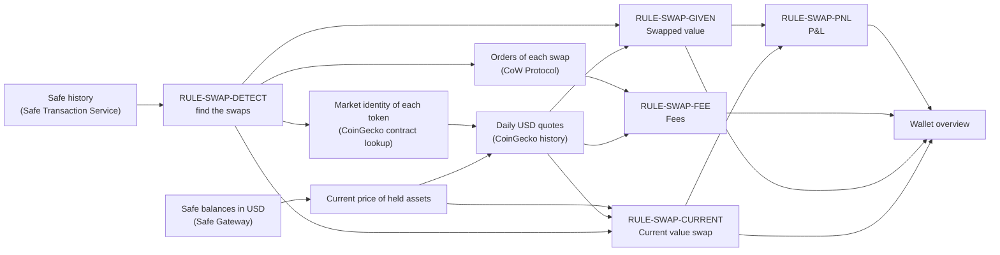

# Safe Swap P&L Use Cases and Calculation Rules

**Scope:** Swaps made by the company Safe, the four figures the Wallet overview shows for them, and the rules that compute each figure

**Status:** Implemented in the client; every use case has a frontend scenario test; validation on a live Safe remains pending

**Last reviewed:** Not yet reviewed

This catalogue covers **Safe transactions that exchange one asset for another**. Identify the use case from the Safe history, then find its
**calculation rules, related user stories, and the figures it produces**. [US-SAFE-007](./README.md#us-safe-007-review-the-safe-swap-pl)
owns the user-facing acceptance criteria. This document owns how each figure is calculated. The Safe swap P&L is a treasury indicator: it
creates no journal entry, and [Accounting](../accounting/journal-entry-catalogue.md#safe-swap--evidenced-safe-asset-exchange) keeps its own
booking of the same exchange.

## Reading the Catalogue

| Concept          | Question answered                      | Responsibility                                                      |
| ---------------- | -------------------------------------- | ------------------------------------------------------------------- |
| User story       | What does the company member see?      | Wallet overview figures, their order, and acceptance criteria       |
| Swap use case    | Which kind of swap happened?           | Condition read from the Safe history, rules applied, worked example |
| Calculation rule | How is a figure computed?              | Price source, quantity, and treatment shared by several use cases   |
| Overview figure  | What does the Wallet overview display? | Swapped value, Current value swap, Fees, and P&L, in that order     |

- Every figure is in USD. Quantities come from the Safe history in token units, with each token's decimals.
- The figures add up all swaps since the Safe's first transaction. A swap is never split between periods.
- Fees are already part of what each swap gave up. They are shown for information and are never subtracted a second time.
- A figure that cannot be fully priced stays visible and is marked incomplete, never silently treated as complete.

Examples use illustrative prices. The swap day is `2026-06-01` and today is `2026-10-23` unless a use case says otherwise.

## Identifier Convention

| Kind             | Format             | Example            | Use                                                       |
| ---------------- | ------------------ | ------------------ | --------------------------------------------------------- |
| Swap use case    | `UC-SWAP-<NNN>`    | `UC-SWAP-001`      | A defined swap scenario with its rules and worked example |
| Calculation rule | `RULE-SWAP-<KIND>` | `RULE-SWAP-DETECT` | A calculation step applied by several use cases           |

Each `UC-SWAP-*` identifier prefixes the scenario test that replays it, so a use case can be traced to its executable evidence.

## Calculation Flow

## Calculation Rule Reference

### `RULE-SWAP-DETECT` — Swap Detection

- Read every native-coin and ERC-20 transfer of the Safe and group them by transaction.
- Inside one transaction, add up the quantities of each asset: what arrives counts as positive, what leaves counts as negative.
- A transaction is a swap when, after this netting, at least one asset left the Safe and at least one different asset arrived.
- NFTs, transfers from the Safe to itself, and transfers whose amount or decimals cannot be read are ignored.
- Swaps are kept in chain order, and each one is dated with the UTC day of its execution.

### `RULE-SWAP-GIVEN` — Swapped Value

`Swapped value = Σ quantity given × USD price of that asset on the swap's UTC day`

The price is the CoinGecko daily quote for that day. A USD stablecoin uses `RULE-SWAP-PEG` instead.

### `RULE-SWAP-CURRENT` — Current Value Swap

`Current value swap = Σ quantity received × current USD price of that asset`

- When the Safe still holds the asset, the current price is the Safe Gateway USD price, the one behind the wallet total.
- When the Safe no longer holds it, the current price is today's CoinGecko daily quote.
- A USD stablecoin uses `RULE-SWAP-PEG`.
- The quantity is the one the swap delivered, even if part of it was spent later. The figure judges the swap decision, not what happened to
  the asset afterwards.

### `RULE-SWAP-PEG` — USD Stablecoin Peg

USD Coin (including bridged USDC), Tether, and Dai are valued at $1.00 on every date, so a provider quote of $0.9991 does not create a gain
or a loss.

### `RULE-SWAP-FEE` — Reported Fee

- For each swap, read the CoW Protocol orders settled by that transaction.
- Keep only the orders owned by the Safe, fulfilled, and whose fee token is an asset the Safe gave up in that swap.
- `Fee quantity = executedFee ÷ 10^decimals`, then `Fee in USD = fee quantity × price of the fee token on the swap day`.
- `Fees = Σ fee in USD` over the swaps that report one. The overview says how many swaps report a fee; with none, it shows `—`.

### `RULE-SWAP-PNL` — Profit and Loss

- `P&L = Current value swap − Swapped value`
- `P&L % = P&L ÷ Swapped value`; there is no percentage while the swapped value is zero.
- A P&L that rounds to zero cents is neither a gain nor a loss. A positive P&L is shown as a gain and a negative one as a loss.

### `RULE-SWAP-GAP` — Missing Price

A quantity whose price cannot be found adds nothing to its figure, and its symbol is listed under the figures as incomplete. Prices are
missing when the token has no verified market identity, or when a daily quote cannot be read.

## Use-Case Overview

| Use case      | Title                                     | Rules applied                    | Wallet overview result                         |
| ------------- | ----------------------------------------- | -------------------------------- | ---------------------------------------------- |
| `UC-SWAP-001` | Buy a volatile asset, price rises         | DETECT, GIVEN, CURRENT, PEG, PNL | Gain                                           |
| `UC-SWAP-002` | Buy a volatile asset, price falls         | DETECT, GIVEN, CURRENT, PEG, PNL | Loss                                           |
| `UC-SWAP-003` | Sell a volatile asset for a stablecoin    | DETECT, GIVEN, CURRENT, PEG, PNL | P&L fixed while the stablecoin is held         |
| `UC-SWAP-004` | Exchange two volatile assets              | DETECT, GIVEN, CURRENT, PNL      | P&L follows the asset received                 |
| `UC-SWAP-005` | Exchange two stablecoins                  | DETECT, GIVEN, CURRENT, PEG, PNL | Only the amount lost in the swap               |
| `UC-SWAP-006` | Received asset spent since                | DETECT, GIVEN, CURRENT, PNL      | Valued at today's quote as if kept             |
| `UC-SWAP-007` | Several swaps on different days           | DETECT, GIVEN, CURRENT, PEG, PNL | Totals and a percentage on the total           |
| `UC-SWAP-008` | CoW Protocol swap                         | DETECT, FEE                      | Fees in USD                                    |
| `UC-SWAP-009` | Swap the provider does not report         | DETECT, FEE                      | Fees `—`                                       |
| `UC-SWAP-010` | Only some swaps report a fee              | DETECT, FEE                      | Fees for the reporting swaps, with their count |
| `UC-SWAP-011` | Refund of the sold asset in the same swap | DETECT, GIVEN, CURRENT, PNL      | Only the net amount counts                     |
| `UC-SWAP-012` | A price cannot be found                   | GAP                              | Figures marked incomplete                      |
| `UC-SWAP-013` | History without any swap                  | DETECT                           | Swap figures hidden                            |
| `UC-SWAP-014` | History or balances unavailable           | —                                | Swap figures hidden                            |

### Transactions That Are Not Swaps

| Transaction                                       | Why it is not a swap                                   | Owning story                                                |
| ------------------------------------------------- | ------------------------------------------------------ | ----------------------------------------------------------- |
| A deposit into the Safe                           | Nothing leaves the Safe                                | [US-SAFE-003](./README.md#us-safe-003-manage-safe-funds)    |
| A payment or transfer out of the Safe             | Nothing arrives in the Safe                            | [US-SAFE-003](./README.md#us-safe-003-manage-safe-funds)    |
| A payment partly returned in the same transaction | The same asset leaves and returns; it nets to one side | [US-SAFE-003](./README.md#us-safe-003-manage-safe-funds)    |
| An NFT transfer                                   | NFTs have no fungible quantity or USD price            | [US-SAFE-002](./README.md#us-safe-002-inspect-safe-details) |
| A transfer from the Safe to itself                | No asset changes hands                                 | [US-SAFE-002](./README.md#us-safe-002-inspect-safe-details) |

## Market-Move Use Cases

### `UC-SWAP-001` — Buy a Volatile Asset, Price Rises

**Condition:** The Safe gives a USD stablecoin and receives a volatile asset, which is now worth more than when it was bought.

**Calculation rules:** `RULE-SWAP-DETECT`, `RULE-SWAP-GIVEN` with `RULE-SWAP-PEG`, `RULE-SWAP-CURRENT`, `RULE-SWAP-PNL`.

**Scenarios and related user stories:**

| Scenario                                                      | Related user stories and criteria                                                                                                                   |
| ------------------------------------------------------------- | --------------------------------------------------------------------------------------------------------------------------------------------------- |
| The treasury buys WETH with USDC and keeps it while it rises. | [US-SAFE-007](./README.md#us-safe-007-review-the-safe-swap-pl) — `AC-US-SAFE-007-01`, `AC-US-SAFE-007-03`, `AC-US-SAFE-007-04`, `AC-US-SAFE-007-05` |

- **Result:** The P&L is positive and shown as a gain.

For 1,000 USDC swapped for 0.5 WETH, with WETH now at $2,400 in the Safe balances:

| Figure             | Calculation        | Value (USD) |
| ------------------ | ------------------ | ----------: |
| Swapped value      | 1,000 USDC × $1.00 |    1,000.00 |
| Current value swap | 0.5 WETH × $2,400  |    1,200.00 |
| Fees               | No fee reported    |           — |
| P&L                | 1,200 − 1,000      |      200.00 |
| P&L %              | 200 ÷ 1,000        |     +20.00% |

### `UC-SWAP-002` — Buy a Volatile Asset, Price Falls

**Condition:** The Safe gives a USD stablecoin and receives a volatile asset, which is now worth less than when it was bought.

**Calculation rules:** `RULE-SWAP-DETECT`, `RULE-SWAP-GIVEN` with `RULE-SWAP-PEG`, `RULE-SWAP-CURRENT`, `RULE-SWAP-PNL`.

**Scenarios and related user stories:**

| Scenario                                              | Related user stories and criteria                                                                         |
| ----------------------------------------------------- | --------------------------------------------------------------------------------------------------------- |
| The treasury buys WETH with USDC and WETH then drops. | [US-SAFE-007](./README.md#us-safe-007-review-the-safe-swap-pl) — `AC-US-SAFE-007-04`, `AC-US-SAFE-007-05` |

- **Result:** The P&L is negative and shown as a loss.

For the same 1,000 USDC swap, with WETH now at $1,800:

| Figure             | Calculation        | Value (USD) |
| ------------------ | ------------------ | ----------: |
| Swapped value      | 1,000 USDC × $1.00 |    1,000.00 |
| Current value swap | 0.5 WETH × $1,800  |      900.00 |
| P&L                | 900 − 1,000        |     −100.00 |
| P&L %              | −100 ÷ 1,000       |     −10.00% |

### `UC-SWAP-003` — Sell a Volatile Asset for a Stablecoin

**Condition:** The Safe gives a volatile asset and receives a USD stablecoin.

**Calculation rules:** `RULE-SWAP-DETECT`, `RULE-SWAP-GIVEN`, `RULE-SWAP-CURRENT` with `RULE-SWAP-PEG`, `RULE-SWAP-PNL`.

**Scenarios and related user stories:**

| Scenario                                                | Related user stories and criteria                                                                                              |
| ------------------------------------------------------- | ------------------------------------------------------------------------------------------------------------------------------ |
| The treasury converts WETH into USDC to lock its value. | [US-SAFE-007](./README.md#us-safe-007-review-the-safe-swap-pl) — `AC-US-SAFE-007-03`, `AC-US-SAFE-007-05`, `AC-US-SAFE-007-06` |

- **Result:** The P&L shows what the swap cost compared with the WETH price of its day. It then stays fixed while the USDC is held, because
  USDC keeps its $1.00 peg even when the Gateway quotes $0.9991.

For 1 WETH worth $3,000 on the swap day, swapped for 2,990 USDC:

| Figure             | Calculation        | Value (USD) |
| ------------------ | ------------------ | ----------: |
| Swapped value      | 1 WETH × $3,000    |    3,000.00 |
| Current value swap | 2,990 USDC × $1.00 |    2,990.00 |
| P&L                | 2,990 − 3,000      |      −10.00 |

### `UC-SWAP-004` — Exchange Two Volatile Assets

**Condition:** The Safe gives a volatile asset and receives another volatile asset.

**Calculation rules:** `RULE-SWAP-DETECT`, `RULE-SWAP-GIVEN`, `RULE-SWAP-CURRENT`, `RULE-SWAP-PNL`.

**Scenarios and related user stories:**

| Scenario                         | Related user stories and criteria                                                                         |
| -------------------------------- | --------------------------------------------------------------------------------------------------------- |
| The treasury swaps POL for WETH. | [US-SAFE-007](./README.md#us-safe-007-review-the-safe-swap-pl) — `AC-US-SAFE-007-03`, `AC-US-SAFE-007-04` |

- **Result:** The asset given is valued at its swap-day quote and the asset received at its current price, so the P&L follows the asset
  received.

For 2,000 POL at $0.25 on the swap day, swapped for 0.2 WETH now at $2,600:

| Figure             | Calculation       | Value (USD) |
| ------------------ | ----------------- | ----------: |
| Swapped value      | 2,000 POL × $0.25 |      500.00 |
| Current value swap | 0.2 WETH × $2,600 |      520.00 |
| P&L                | 520 − 500         |       20.00 |
| P&L %              | 20 ÷ 500          |      +4.00% |

### `UC-SWAP-005` — Exchange Two Stablecoins

**Condition:** The Safe gives a USD stablecoin and receives another USD stablecoin.

**Calculation rules:** `RULE-SWAP-DETECT`, `RULE-SWAP-GIVEN` and `RULE-SWAP-CURRENT` with `RULE-SWAP-PEG`, `RULE-SWAP-PNL`.

**Scenarios and related user stories:**

| Scenario                               | Related user stories and criteria                                                    |
| -------------------------------------- | ------------------------------------------------------------------------------------ |
| The treasury converts USDC into USDCe. | [US-SAFE-007](./README.md#us-safe-007-review-the-safe-swap-pl) — `AC-US-SAFE-007-06` |

- **Result:** Both sides are worth $1.00 per unit, so the P&L is exactly the quantity lost in the swap: fees, price impact, and slippage.

For 1,000 USDC swapped for 998.5 USDCe:

| Figure             | Calculation         | Value (USD) |
| ------------------ | ------------------- | ----------: |
| Swapped value      | 1,000 USDC × $1.00  |    1,000.00 |
| Current value swap | 998.5 USDCe × $1.00 |      998.50 |
| P&L                | 998.5 − 1,000       |       −1.50 |

## After-Swap Use Cases

### `UC-SWAP-006` — Received Asset Spent Since

**Condition:** An asset received in a swap later left the Safe, so the Safe Gateway no longer prices it.

**Calculation rules:** `RULE-SWAP-DETECT`, `RULE-SWAP-GIVEN`, `RULE-SWAP-CURRENT` with today's quote, `RULE-SWAP-PNL`.

**Scenarios and related user stories:**

| Scenario                                         | Related user stories and criteria                                                                                                                                       |
| ------------------------------------------------ | ----------------------------------------------------------------------------------------------------------------------------------------------------------------------- |
| The WETH bought in June paid a supplier in July. | [US-SAFE-007](./README.md#us-safe-007-review-the-safe-swap-pl) — `AC-US-SAFE-007-04`; [US-SAFE-003](./README.md#us-safe-003-manage-safe-funds) — owns the later payment |

- **Result:** The later payment is not a swap and changes neither figure. The received quantity is valued at today's CoinGecko quote, as if
  it had been kept.

For 1,000 USDC swapped for 0.5 WETH, all of it paid away since, with today's WETH quote at $2,200:

| Figure             | Calculation                       | Value (USD) |
| ------------------ | --------------------------------- | ----------: |
| Swapped value      | 1,000 USDC × $1.00                |    1,000.00 |
| Current value swap | 0.5 WETH × $2,200 (today's quote) |    1,100.00 |
| P&L                | 1,100 − 1,000                     |      100.00 |

### `UC-SWAP-007` — Several Swaps on Different Days

**Condition:** The Safe made more than one swap.

**Calculation rules:** `RULE-SWAP-DETECT`, `RULE-SWAP-GIVEN` per swap day, `RULE-SWAP-CURRENT`, `RULE-SWAP-PEG`, `RULE-SWAP-PNL`.

**Scenarios and related user stories:**

| Scenario                                               | Related user stories and criteria                                                                         |
| ------------------------------------------------------ | --------------------------------------------------------------------------------------------------------- |
| The treasury buys WETH in June and sells WETH in July. | [US-SAFE-007](./README.md#us-safe-007-review-the-safe-swap-pl) — `AC-US-SAFE-007-01`, `AC-US-SAFE-007-03` |

- **Result:** Each swap uses the price of its own day. The overview shows the number of swaps, the sums, and one percentage computed on the
  summed swapped value.

For a June swap of 1,000 USDC for 0.5 WETH, and a July swap of 1 WETH (worth $2,600 that day) for 2,500 USDC, with WETH now at $2,400:

| Figure             | Calculation                                | Value (USD) |
| ------------------ | ------------------------------------------ | ----------: |
| Swaps              | June and July                              |           2 |
| Swapped value      | (1,000 USDC × $1.00) + (1 WETH × $2,600)   |    3,600.00 |
| Current value swap | (0.5 WETH × $2,400) + (2,500 USDC × $1.00) |    3,700.00 |
| P&L                | 3,700 − 3,600                              |      100.00 |
| P&L %              | 100 ÷ 3,600                                |      +2.78% |

## Fee Use Cases

### `UC-SWAP-008` — CoW Protocol Swap

**Condition:** CoW Protocol reports a fulfilled order owned by the Safe for the swap transaction.

**Calculation rules:** `RULE-SWAP-DETECT`, `RULE-SWAP-FEE`.

**Scenarios and related user stories:**

| Scenario                                 | Related user stories and criteria                                                    |
| ---------------------------------------- | ------------------------------------------------------------------------------------ |
| The treasury swaps through CoW Protocol. | [US-SAFE-007](./README.md#us-safe-007-review-the-safe-swap-pl) — `AC-US-SAFE-007-07` |

- **Result:** Fees show the reported amount in USD. The P&L is unchanged, because the fee was already taken from what the Safe gave up.

For a 1,000 USDC swap whose order reports `executedFee = 3500000` in USDC (6 decimals):

| Figure | Calculation                         | Value (USD) |
| ------ | ----------------------------------- | ----------: |
| Fees   | 3,500,000 ÷ 10^6 = 3.5 USDC × $1.00 |        3.50 |
| P&L    | Same as `UC-SWAP-001`               |      200.00 |

### `UC-SWAP-009` — Swap the Provider Does Not Report

**Condition:** CoW Protocol returns no order of the Safe for the swap transaction, for example a swap made through another protocol.

**Calculation rules:** `RULE-SWAP-DETECT`, `RULE-SWAP-FEE`.

**Scenarios and related user stories:**

| Scenario                                             | Related user stories and criteria                                                    |
| ---------------------------------------------------- | ------------------------------------------------------------------------------------ |
| The treasury swaps through a decentralized exchange. | [US-SAFE-007](./README.md#us-safe-007-review-the-safe-swap-pl) — `AC-US-SAFE-007-07` |

- **Result:** Fees show `—` and their tooltip says no fee is reported. The other figures are unaffected. A failed CoW lookup behaves the
  same way.

### `UC-SWAP-010` — Only Some Swaps Report a Fee

**Condition:** At least one swap reports a CoW Protocol fee and at least one does not.

**Calculation rules:** `RULE-SWAP-DETECT`, `RULE-SWAP-FEE`.

**Scenarios and related user stories:**

| Scenario                                                      | Related user stories and criteria                                                    |
| ------------------------------------------------------------- | ------------------------------------------------------------------------------------ |
| One swap goes through CoW Protocol and another through a DEX. | [US-SAFE-007](./README.md#us-safe-007-review-the-safe-swap-pl) — `AC-US-SAFE-007-07` |

- **Result:** Fees add up the reported fees only, and their tooltip says how many swaps they cover.

For two 1,000 USDC swaps, one reporting a 3.5 USDC fee:

| Figure        | Calculation                    | Value (USD) |
| ------------- | ------------------------------ | ----------: |
| Swapped value | 1,000 + 1,000                  |    2,000.00 |
| Fees          | 3.5 USDC × $1.00, 1 of 2 swaps |        3.50 |

## Edge-Case Use Cases

### `UC-SWAP-011` — Refund of the Sold Asset in the Same Swap

**Condition:** In one swap transaction, part of the asset the Safe sent comes back to it.

**Calculation rules:** `RULE-SWAP-DETECT` netting, `RULE-SWAP-GIVEN`, `RULE-SWAP-CURRENT`, `RULE-SWAP-PNL`.

**Scenarios and related user stories:**

| Scenario                                                 | Related user stories and criteria                                                    |
| -------------------------------------------------------- | ------------------------------------------------------------------------------------ |
| A swap returns the unused part of the USDC it was given. | [US-SAFE-007](./README.md#us-safe-007-review-the-safe-swap-pl) — `AC-US-SAFE-007-02` |

- **Result:** Only the net quantity given counts. The refund is not a second trade.

For 1,000 USDC sent, 20 USDC returned, and 0.49 WETH received, with WETH now at $2,400:

| Figure             | Calculation               | Value (USD) |
| ------------------ | ------------------------- | ----------: |
| Swapped value      | (1,000 − 20) USDC × $1.00 |      980.00 |
| Current value swap | 0.49 WETH × $2,400        |    1,176.00 |
| P&L                | 1,176 − 980               |      196.00 |

### `UC-SWAP-012` — A Price Cannot Be Found

**Condition:** A swapped asset has no verified market identity, or one of its daily quotes cannot be read.

**Calculation rules:** `RULE-SWAP-GAP`.

**Scenarios and related user stories:**

| Scenario                                                   | Related user stories and criteria                                                    |
| ---------------------------------------------------------- | ------------------------------------------------------------------------------------ |
| The WETH bought is no longer held and today's quote fails. | [US-SAFE-007](./README.md#us-safe-007-review-the-safe-swap-pl) — `AC-US-SAFE-007-08` |

- **Result:** The unpriced quantity adds nothing to its figure. Under the figures, the overview says `Incomplete: no USD price for WETH.`

For 1,000 USDC swapped for 0.5 WETH with no WETH price:

| Figure             | Calculation              |      Value (USD) |
| ------------------ | ------------------------ | ---------------: |
| Swapped value      | 1,000 USDC × $1.00       |         1,000.00 |
| Current value swap | 0.5 WETH × unknown price | 0.00, incomplete |

### `UC-SWAP-013` — History Without Any Swap

**Condition:** The Safe history contains deposits, payments, or partly returned payments, but no transaction that exchanges two assets.

**Calculation rules:** `RULE-SWAP-DETECT`.

**Scenarios and related user stories:**

| Scenario                                        | Related user stories and criteria                                                    |
| ----------------------------------------------- | ------------------------------------------------------------------------------------ |
| A Safe that only received funds and paid bills. | [US-SAFE-007](./README.md#us-safe-007-review-the-safe-swap-pl) — `AC-US-SAFE-007-09` |

- **Result:** No swap is found and the swap figures stay hidden. The rest of the Wallet overview is unchanged.

### `UC-SWAP-014` — History or Balances Unavailable

**Condition:** The Safe history or the Safe balances cannot be read, or the daily quotes are still loading.

**Calculation rules:** None; nothing is computed until every source has answered.

**Scenarios and related user stories:**

| Scenario                              | Related user stories and criteria                                                                                                                                            |
| ------------------------------------- | ---------------------------------------------------------------------------------------------------------------------------------------------------------------------------- |
| The Safe Transaction Service is down. | [US-SAFE-007](./README.md#us-safe-007-review-the-safe-swap-pl) — `AC-US-SAFE-007-09`; [US-SAFE-002](./README.md#us-safe-002-inspect-safe-details) — reports the read failure |

- **Result:** The swap figures stay hidden instead of showing partial sums. The overview keeps reporting the read failure as it already
  does.

## Known Limits

- Daily quotes are the CoinGecko price of the swap's UTC day, not the exact price at the second of execution.
- Only CoW Protocol fees are read. Fees of other protocols are not reported, and network gas paid by another wallet is never counted.
- Current value swap values the quantity received, not the quantity still held, by design (`UC-SWAP-006`).
- The figures have not been checked against a live Safe that swapped through CoW Protocol yet.

## Implementation Evidence

The canonical attestation for these sources is held by the [Accounts implementation evidence](./README.md#implementation-evidence).

- [Swap detection and P&L](../../../app/src/utils/safe/swapPnl.ts) — `RULE-SWAP-DETECT`, `RULE-SWAP-GIVEN`, `RULE-SWAP-CURRENT`,
  `RULE-SWAP-PNL`, `RULE-SWAP-GAP`
- [Swap valuation and CoW fees](../../../app/src/utils/safe/swapValuation.ts) — price sources, `RULE-SWAP-PEG`, `RULE-SWAP-FEE`
- [Swap P&L composable](../../../app/src/composables/safe/useSafeSwapPnl.ts) — source loading and `UC-SWAP-014`
- [CoW order query](../../../app/src/queries/cow.queries.ts) and [CoW order fields](../../../app/src/types/cow.ts)
- [Wallet overview swap figures](../../../app/src/components/sections/SafeView/SafeSwapPnlCard.vue)
- [Use-case scenario tests](../../../app/src/utils/safe/__tests__/swapPnl.integration.spec.ts) — `UC-SWAP-001` to `UC-SWAP-013`
- [Composable tests](../../../app/src/composables/safe/__tests__/useSafeSwapPnl.spec.ts) — `UC-SWAP-014`
- [Rule tests](../../../app/src/utils/safe/__tests__/swapPnl.spec.ts),
  [valuation tests](../../../app/src/utils/safe/__tests__/swapValuation.spec.ts), and
  [overview figure tests](../../../app/src/components/sections/SafeView/__tests__/SafeSwapPnlCard.spec.ts)

## Related Documentation

- [Accounts user stories](./README.md)
- [Accounting rule catalogue](../accounting/journal-entry-catalogue.md)
- [Client Data Access](../../implementation/client-data-access/README.md)
