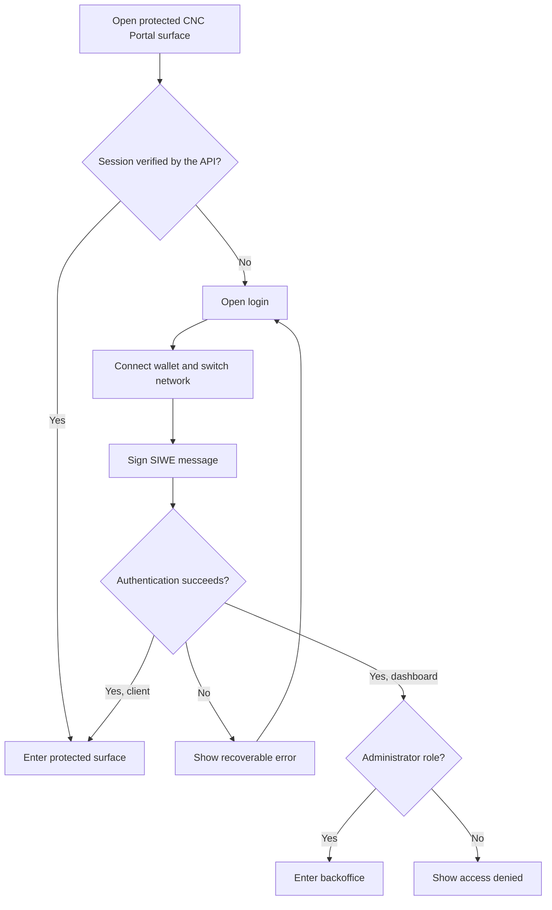

# Authentication — User Stories

**Scope:** Wallet-based sign-in, protected entry, and client wallet-session recovery

**Last reviewed:** 2026-10-21

These acceptance criteria follow the
[feature documentation review contract](../../platform/feature-specification-guide.md#human-review-contract).

## Product Model

CNC Portal uses Sign-In with Ethereum. The user connects a wallet, switches to the configured network, and signs a message. Signing in does
not submit an on-chain transaction and does not consume gas.

The client accepts an authenticated portal user. The dashboard additionally requires a persisted administrator role. Authentication proves
wallet ownership; authorization decides which product surface the user may enter.

The authenticated client locks its workspace when the connected wallet is on another or an unknown network. The user can request the
configured network and resume the same session after a successful switch. Production targets Polygon. This session policy is shared by all
client features; signature-domain validation remains with its API and contract owners.

The portal checks the saved session with the API before opening a protected page. While the check is pending, the workspace stays hidden. A
rejected or unavailable session check leads to sign-in. Expiry while the portal is open also returns the user to sign-in.

## Lifecycle

## Status Overview

| User Story  | Title                                | Actor                     | Status         |
| ----------- | ------------------------------------ | ------------------------- | -------------- |
| US-AUTH-001 | Sign in to the client                | Portal user               | 🧪 Validation  |
| US-AUTH-002 | Sign in to the backoffice            | Platform administrator    | 🚧 In Progress |
| US-AUTH-004 | Resume after a wallet network change | Authenticated portal user | 🧪 Validation  |

## Test Coverage Overview

Coverage targets compare each criterion's required evidence with direct representative `AC-US-*` references. They do not describe the latest
test run. Client sign-in has an integrated path. Session recovery uses browser and focused tests, and the backoffice has focused tests for
its sign-in and route guard. The client stories remain in Validation pending human product review. The backoffice still has a session
freshness gap.

Runs of at least three consecutive missing criteria use inclusive ranges with full AC IDs at both endpoints.

| User Story  | Main Journey  | Coverage Target | Gaps                |
| ----------- | ------------- | --------------- | ------------------- |
| US-AUTH-001 | ✅ Integrated | ✅ 18/18 met    | —                   |
| US-AUTH-002 | ⬜ Planned    | ⚠️ 9/10         | `AC-US-AUTH-002-10` |
| US-AUTH-004 | ✅ Browser    | ✅ 7/7 met      | —                   |

Proof obligations use the [shared proof-strategy registry](../../testing/proof-strategies.md). Multiple IDs for one AC are cumulative.

## US-AUTH-001: Sign in to the Client

**As a** portal user\
**I want to** authenticate by signing a message with my wallet\
**So that** I can access my companies without submitting a blockchain transaction

### Acceptance Criteria

#### Happy Path

- [x] `AC-US-AUTH-001-01` A portal user can authenticate by signing a SIWE message and access their companies.
- [x] `AC-US-AUTH-001-02` An unknown wallet address receives a default portal user account after successful authentication.

#### Business Rules

- [x] `AC-US-AUTH-001-03` The wallet is connected and switched to the configured network before the SIWE message is signed.
- [x] `AC-US-AUTH-001-04` The SIWE message binds the wallet address, nonce, chain, domain, URI, and protocol version.
- [x] `AC-US-AUTH-001-05` The backend verifies the message signature and current nonce before authenticating the user.
- [x] `AC-US-AUTH-001-06` Successful authentication rotates the nonce and issues a JWT valid for 24 hours.
- [x] `AC-US-AUTH-001-07` Authentication signs a message without submitting an on-chain transaction or consuming gas.

#### Edge & Error Cases

- [x] `AC-US-AUTH-001-08` At startup, protected client routes, including parameterized detail routes, remain hidden while the saved session
      is being verified. If the verification endpoint rejects the current token (`401`), the saved session is cleared and the user is
      returned to sign-in.
- [x] `AC-US-AUTH-001-09` An invalid SIWE message or signature is rejected without authenticating the user.
- [x] `AC-US-AUTH-001-10` If session verification remains unavailable after retries, the user stays outside the workspace and sees sign-in.
      The saved token is retained so reloading can retry verification without a new wallet signature.
- [x] `AC-US-AUTH-001-11` When a signed-in user is denied access to a protected resource or action (`403`), the refusal stays within the
      affected feature. The user stays signed in for other permitted actions.
- [x] `AC-US-AUTH-001-12` During an active session, a protected API request that receives `401` for the current token ends the session and
      returns the user to sign-in.

- [x] `AC-US-AUTH-001-13` After an unsuccessful sign-in, the user can start the same SIWE sign-in flow again.
- [x] `AC-US-AUTH-001-14` A declined wallet connection, network switch, or signature request, or an unavailable wallet provider, leaves the
      user signed out.
- [x] `AC-US-AUTH-001-15` If nonce retrieval, signature verification, or profile loading fails, the sign-in attempt grants no access to
      protected client routes.
- [x] `AC-US-AUTH-001-16` A failed sign-in identifies whether the failure occurred at wallet connection, network switching, signing, or a
      backend request so the user can retry.
- [x] `AC-US-AUTH-001-17` During sign-in, a terminal profile response (`401`, `403`, or `404`) discards the newly issued token.
- [x] `AC-US-AUTH-001-18` A transient profile failure keeps the wallet connected and the issued token available while sign-in remains
      incomplete.

### Test Coverage

| Acceptance Criterion | Proof Strategy      | Current Evidence                    | Status |
| -------------------- | ------------------- | ----------------------------------- | ------ |
| `AC-US-AUTH-001-01`  | `PS-API-INTEGRATED` | Integrated E2E + Frontend + Backend | ✅ Met |
| `AC-US-AUTH-001-01`  | `PS-BACKEND`        | Integrated E2E + Frontend + Backend | ✅ Met |
| `AC-US-AUTH-001-02`  | `PS-BACKEND`        | Backend                             | ✅ Met |
| `AC-US-AUTH-001-03`  | `PS-FRONTEND`       | Frontend                            | ✅ Met |
| `AC-US-AUTH-001-04`  | `PS-FRONTEND`       | Frontend + Backend                  | ✅ Met |
| `AC-US-AUTH-001-04`  | `PS-BACKEND`        | Frontend + Backend                  | ✅ Met |
| `AC-US-AUTH-001-05`  | `PS-BACKEND`        | Backend                             | ✅ Met |
| `AC-US-AUTH-001-06`  | `PS-BACKEND`        | Backend                             | ✅ Met |
| `AC-US-AUTH-001-07`  | `PS-API-INTEGRATED` | Integrated E2E                      | ✅ Met |
| `AC-US-AUTH-001-08`  | `PS-FRONTEND`       | Mocked browser + Frontend           | ✅ Met |
| `AC-US-AUTH-001-09`  | `PS-BACKEND`        | Backend                             | ✅ Met |
| `AC-US-AUTH-001-10`  | `PS-BROWSER`        | Mocked browser                      | ✅ Met |
| `AC-US-AUTH-001-11`  | `PS-BROWSER`        | Mocked browser                      | ✅ Met |
| `AC-US-AUTH-001-12`  | `PS-BROWSER`        | Mocked browser                      | ✅ Met |
| `AC-US-AUTH-001-13`  | `PS-BROWSER`        | Mocked browser                      | ✅ Met |
| `AC-US-AUTH-001-14`  | `PS-FRONTEND`       | Frontend                            | ✅ Met |
| `AC-US-AUTH-001-15`  | `PS-BROWSER`        | Mocked browser                      | ✅ Met |
| `AC-US-AUTH-001-16`  | `PS-FRONTEND`       | Frontend                            | ✅ Met |
| `AC-US-AUTH-001-17`  | `PS-FRONTEND`       | Frontend                            | ✅ Met |
| `AC-US-AUTH-001-18`  | `PS-FRONTEND`       | Frontend                            | ✅ Met |

## US-AUTH-002: Sign in to the Backoffice

**As a** platform administrator\
**I want to** authenticate with my wallet and persisted administrator role\
**So that** I can access protected backoffice capabilities

### Acceptance Criteria

#### Happy Path

- [x] `AC-US-AUTH-002-01` A platform administrator can connect a wallet, sign a SIWE message, and access the backoffice.
- [x] `AC-US-AUTH-002-02` Wallet connection can be completed before the authentication message is signed.

#### Business Rules

- [x] `AC-US-AUTH-002-03` Protected backoffice capabilities require an authenticated user with an administrator or super-administrator role.
- [x] `AC-US-AUTH-002-04` Successful backoffice authentication persists the access token and authenticated wallet address.
- [x] `AC-US-AUTH-002-05` Logging out clears the persisted session, disconnects the wallet, and returns the user to login.

#### Edge & Error Cases

- [x] `AC-US-AUTH-002-06` A missing access token or wallet address redirects the user to login.
- [x] `AC-US-AUTH-002-07` An authenticated user without an administrator role is denied access to protected backoffice capabilities.
- [x] `AC-US-AUTH-002-08` A failed token or user validation clears the persisted backoffice session and redirects the user to login.
- [x] `AC-US-AUTH-002-09` A failed backoffice sign-in distinguishes declined wallet prompts, network mismatch, backend rejection, and
      connectivity problems.
- [ ] `AC-US-AUTH-002-10` A saved administrator profile cannot grant entry to a protected backoffice route when the current token has
      expired or been replaced by an unverified token.

### Test Coverage

| Acceptance Criterion | Proof Strategy | Current Evidence    | Status     |
| -------------------- | -------------- | ------------------- | ---------- |
| `AC-US-AUTH-002-01`  | `PS-DASHBOARD` | Backend + Dashboard | ✅ Met     |
| `AC-US-AUTH-002-01`  | `PS-BACKEND`   | Backend + Dashboard | ✅ Met     |
| `AC-US-AUTH-002-02`  | `PS-DASHBOARD` | Dashboard           | ✅ Met     |
| `AC-US-AUTH-002-03`  | `PS-DASHBOARD` | Backend + Dashboard | ✅ Met     |
| `AC-US-AUTH-002-03`  | `PS-BACKEND`   | Backend + Dashboard | ✅ Met     |
| `AC-US-AUTH-002-04`  | `PS-DASHBOARD` | Dashboard           | ✅ Met     |
| `AC-US-AUTH-002-05`  | `PS-DASHBOARD` | Dashboard           | ✅ Met     |
| `AC-US-AUTH-002-06`  | `PS-DASHBOARD` | Dashboard           | ✅ Met     |
| `AC-US-AUTH-002-07`  | `PS-DASHBOARD` | Backend + Dashboard | ✅ Met     |
| `AC-US-AUTH-002-07`  | `PS-BACKEND`   | Backend + Dashboard | ✅ Met     |
| `AC-US-AUTH-002-08`  | `PS-DASHBOARD` | Dashboard           | ✅ Met     |
| `AC-US-AUTH-002-09`  | `PS-DASHBOARD` | Dashboard           | ✅ Met     |
| `AC-US-AUTH-002-10`  | `PS-DASHBOARD` | None linked         | ❌ Missing |

## US-AUTH-004: Resume after a Wallet Network Change

**As a** portal user with an authenticated session\
**I want to** return my wallet to the application's network after a network change\
**So that** I can resume my company session on the intended network

### Acceptance Criteria

#### Happy Path

- [x] `AC-US-AUTH-004-01` Returning the connected wallet to the configured network restores the same authenticated route without requiring
      another login.
- [x] `AC-US-AUTH-004-02` A user can request the configured network from the locked session.

#### Business Rules

- [x] `AC-US-AUTH-004-03` An authenticated session on another or an unknown wallet network cannot interact with the protected workspace,
      including open transaction dialogs.
- [x] `AC-US-AUTH-004-04` Network recovery does not automatically submit or replay a transaction.
- [x] `AC-US-AUTH-004-05` If the connected wallet differs from the authenticated account, the workspace locks. Disconnecting the wallet ends
      the session so the user can sign in again.

#### Edge & Error Cases

- [x] `AC-US-AUTH-004-06` A rejected, failed or unsupported network switch keeps the session locked and allows a deliberate retry without
      repeated automatic requests.
- [x] `AC-US-AUTH-004-07` Transaction requests still being prepared when the wallet changes network are bound to the configured chain or
      rejected before submission; already submitted wallet requests are not cancelled by the screen lock.

### Test Coverage

| Acceptance Criterion | Proof Strategy | Current Evidence                           | Status |
| -------------------- | -------------- | ------------------------------------------ | ------ |
| `AC-US-AUTH-004-01`  | `PS-BROWSER`   | Integrated E2E + Mocked browser + Frontend | ✅ Met |
| `AC-US-AUTH-004-02`  | `PS-BROWSER`   | Mocked browser + Frontend                  | ✅ Met |
| `AC-US-AUTH-004-03`  | `PS-BROWSER`   | Integrated E2E + Mocked browser + Frontend | ✅ Met |
| `AC-US-AUTH-004-04`  | `PS-BROWSER`   | Integrated E2E + Mocked browser + Frontend | ✅ Met |
| `AC-US-AUTH-004-05`  | `PS-FRONTEND`  | Frontend                                   | ✅ Met |
| `AC-US-AUTH-004-06`  | `PS-BROWSER`   | Mocked browser + Frontend                  | ✅ Met |
| `AC-US-AUTH-004-07`  | `PS-FRONTEND`  | Frontend                                   | ✅ Met |

**Cross-domain relationship:** This is a shared session policy consumed by every authenticated client route, including Accounts, Payroll,
governance, Contract Management and Safe. Each domain retains its operation, authorization and signature rules. The
[shared contract-interaction owner](../../implementation/contract-interactions/README.md) documents submission boundaries and exceptions.

## Known Gaps

- `AC-US-AUTH-002-10`: the backoffice guard can reuse an address-keyed profile across tokens. The role and rejection tests exercise a fresh
  profile check. Closing this gap requires a test that changes or expires the token after caching the administrator profile and verifies
  that the next protected navigation requires confirmation.

### Retired story

`US-AUTH-003` described recovery inside the existing sign-in flow. Its client criteria moved to `AC-US-AUTH-001-13`–`AC-US-AUTH-001-18`.
Former criteria `003-03` and `003-08` are consolidated under `001-15`, and `003-07` is included in `001-14`. The backoffice error criterion
`003-05` moved to `002-09`, and the wallet-account mismatch criterion `003-09` is covered by `004-05`. The retired story ID remains
reserved.

## Implementation Evidence

**Implementation evidence reviewed against:** `8c7c2e2adf8516c8bb269320301c296ea2ce99c3`

- [Network lock screen](../../../app/src/components/layout/NetworkLockScreen.vue),
  [network-lock tests](../../../app/src/components/layout/__tests__/NetworkLockScreen.spec.ts),
  [browser network-recovery journey](../../../app/test/e2e/wallet-network.spec.ts), and
  [E2E wallet network fixture](../../../app/src/e2e/mockConnector.ts)
- [Client login page](../../../app/src/views/LoginView.vue), [session guard](../../../app/src/router/index.ts), and
  [browser session-restoration tests](../../../app/test/e2e/login.spec.ts), and
  [browser session failure and recovery tests](../../../app/test/e2e/auth-session.spec.ts)
- [Client SIWE orchestration](../../../app/src/composables/useSiwe.ts)
- [Client SIWE tests](../../../app/src/composables/__tests__/useSiwe.spec.ts)
- [Dashboard login page](../../../dashboard/app/pages/login.vue)
- [Dashboard SIWE orchestration](../../../dashboard/app/composables/useSiwe.ts)
- [Dashboard route guard](../../../dashboard/app/middleware/auth.global.ts)
- [Dashboard login error classification](../../../dashboard/app/utils/loginError.ts) and
  [backoffice authentication tests](../../../dashboard/test/authentication.spec.ts)
- [Backend SIWE controller](../../../backend/src/controllers/authController.ts)
- [Backend authentication middleware](../../../backend/src/middleware/authMiddleware.ts)
- [Backend authentication tests](../../../backend/src/controllers/__tests__/authController.test.ts)

### Test-suite ownership

- [Authentication API tests](../../../app/src/api/__tests__/auth.api.spec.ts),
  [login view tests](../../../app/src/views/__tests__/LoginView.spec.ts),
  [lock-screen tests](../../../app/src/components/layout/__tests__/LockScreen.spec.ts), and
  [application session-boundary tests](../../../app/src/__tests__/App.spec.ts)

## Related Documentation

- [Client Navigation implementation](../../implementation/client-navigation/README.md)
- [Authentication implementation](../../implementation/authentication/README.md)
- [RBAC implementation](../../implementation/rbac/README.md)
- [Security Standards](../../platform/security.md)
