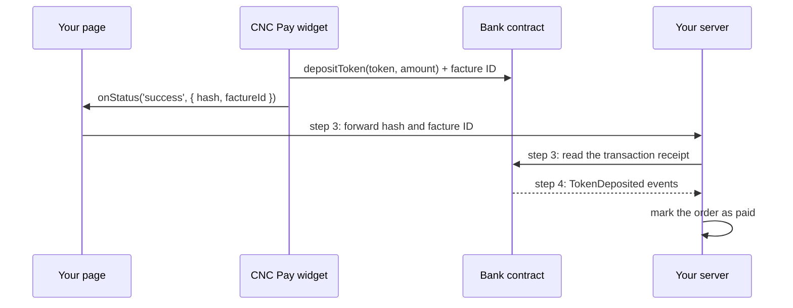

# CNC Pay — Backend Integration Guide

**Status:** Current

**Scope:** How a merchant's own server confirms payments made through the CNC Pay widget

**Audience:** Developers integrating CNC Pay into a merchant site

This guide expands steps 3 and 4 of the company's Payment Gate **Setup** page (`/teams/:id/payment-gate`). The Setup page shows the same
samples, already filled in with the company's Bank address.

## How a Payment Reaches Your Server

Every widget payment is a `depositToken(token, amount)` call from the customer's wallet to your company's Bank contract, with the facture ID
appended to the transaction's input data. The Bank emits `TokenDeposited(address indexed depositor, address indexed token, uint256 amount)`.
Your server learns about the payment in one of two ways:

- **Step 3:** your page forwards the widget's `onStatus` result, and your server checks the transaction on-chain.
- **Step 4:** your server listens to the Bank's `TokenDeposited` events. This also catches payments where the customer closed the page
  before step 3 ran.



## Step 3 — Forward the Result and Check It

`onStatus` reports these values:

| `status`                            | `details`                                   |
| ----------------------------------- | ------------------------------------------- |
| `connecting`, `approving`, `paying` | none                                        |
| `success`                           | `{ hash, factureId }`: the transaction hash |
| `failed`                            | `{ factureId, error }`: no transaction hash |

Send `hash` and `factureId` to an endpoint **you** create on your server. In the Setup page sample, `/api/payments/cnc-pay` is only an
example name. The Vue 3 and React snippets declare a minimal local `CncPayApi` type; add the `details` parameter to it to read these values
in TypeScript.

On your server, before marking the order as paid, read the transaction receipt from any RPC for the widget's network and check that:

- the receipt status is `success`;
- the transaction was sent to your Bank address;
- it emitted your Bank's `TokenDeposited` event with the token and amount of **your own order record**;
- it carries the expected facture ID (see [Reading the facture ID](#reading-the-facture-id)).

## Step 4 — Listen to the Bank

```ts
// On your server (Node.js + viem)
import { createPublicClient, hexToNumber, hexToString, http, parseAbiItem, size, slice } from 'viem'

const client = createPublicClient({ transport: http(process.env.RPC_URL) })

client.watchEvent({
  address: '0xYourBankAddress', // filled in on the Setup page
  event: parseAbiItem('event TokenDeposited(address indexed depositor, address indexed token, uint256 amount)'),
  onLogs: async (logs) => {
    for (const log of logs) {
      const { input } = await client.getTransaction({ hash: log.transactionHash })
      if (size(input) <= 70) continue // a plain deposit, not a widget payment
      const length = hexToNumber(slice(input, 68, 70))
      const factureId = hexToString(slice(input, 70, 70 + length))
      // log.args = { depositor, token, amount }: mark factureId as paid
    }
  }
})
```

`watchEvent` only sees new blocks while your process runs. On start-up, catch up with `client.getLogs` from the last block you processed.

## Reading the Facture ID

The facture ID follows the 68-byte `depositToken(address,uint256)` call in the transaction's input data, as a 2-byte big-endian length and
then the UTF-8 facture ID. The widget's encoder is [`factureCalldata.ts`](../../../app/src/utils/paymentGate/factureCalldata.ts). A deposit
made without the widget has no suffix and is skipped.

## Good Practice

- Treat a facture ID or a forwarded hash as a claim until the on-chain checks pass; anyone can send a deposit or call your endpoint.
- Compare the token and amount with your order: a deposit with the right facture ID but a lower amount is not a full payment.
- Store payments by transaction hash so each is recorded once.

## Related Documentation

- [Payment Gate user stories](./README.md), including
  [`US-PAYGATE-006`](./README.md#us-paygate-006-confirm-a-payment-on-the-merchants-server)
- [Bank contract behaviour](../../contracts/features/bank/README.md)
