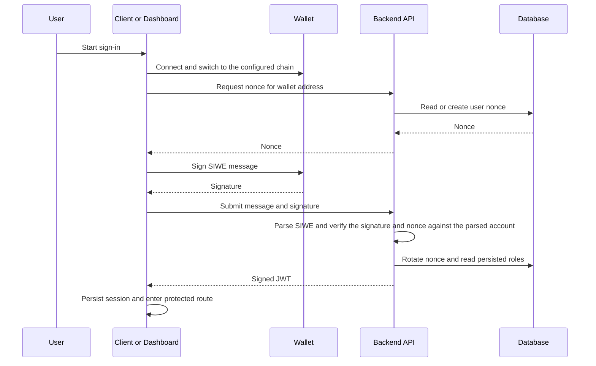

# Authentication Implementation

**Scope:** Shared SIWE authentication, JWT session issuance, and protected-route entry

**Last verified:** 2026-10-21

**Consumers:** [Authentication user journey](../../features/authentication/README.md), the Vue client, the administrator dashboard, and
every authenticated backend route

Authentication has a product facet and an architectural facet. The feature document owns what a user experiences; this document owns the
shared SIWE and session boundaries.

## Runtime Model

## Responsibility Boundaries

- The client and dashboard own wallet connection, chain switching, SIWE message construction, signature prompts, user-facing errors, and
  local session storage.
- The backend owns nonce persistence, SIWE verification, nonce rotation, JWT issuance, and JWT validation.
- RBAC owns authorization after authentication; a valid session does not imply administrator access.
- Wallet signatures authenticate ownership but do not execute a transaction or consume gas.

## Invariants

- The backend verifies the signature and uses the same parsed SIWE account for user lookup, nonce rotation, and the JWT subject.
- An existing user's stored nonce is checked and rotated after verification. First-time registration creates the user with a fresh nonce.
- Private keys never leave the wallet.
- Protected backend routes validate the bearer token before authorization middleware runs.
- The dashboard admits only persisted administrators after authentication.
- On portal startup, the router waits for the backend to verify the saved bearer token before admitting a protected route. The verification
  response is not cacheable. The application shell displays a neutral status while waiting and mounts protected navigation and content only
  for the verified session.
- Verification lives in memory and is bound to the exact token. The client schedules session expiry from the confirmed JWT's expiry claim.
  Logout, expiry, or a protected API response rejecting the current token clears the local session and returns to login.

## Failure Behaviour

- Wallet connection, chain switching, signature rejection, nonce retrieval, authentication, and profile retrieval produce distinct client
  errors where the surface supports them.
- The client keeps the issued token during recoverable profile transport or server failures; the SIWE mutation `onError` clears it only for
  terminal profile responses (`401`, `403`, or `404`) and resets the local user state.
- Invalid SIWE payloads or signatures are rejected by the backend.
- `GET /auth/token` responds with `200` after validating the bearer token and resolving its user. A missing, invalid, expired, or incomplete
  token, or a token for an unknown user, produces `401`. An internal verification failure produces `500`.
- The portal clears the local session only when a `401` applies to the current bearer token. A late rejection of an older token leaves the
  current session active.
- Network errors, timeouts and retryable HTTP responses during startup verification use the shared API client's retry policy. When retries
  are exhausted, the workspace stays hidden and the portal opens sign-in. The saved token can be checked again on reload.
- On an authenticated feature request, `403` is a resource authorization failure. The request's query or mutation exposes it to the feature
  that initiated the request. The portal keeps the session active. The post-sign-in profile lookup above is part of establishing a session
  and has its own failure policy.
- Dashboard role rejection leads to the access-denied page rather than a protected module.

## Implementation Evidence

**Implementation evidence reviewed against:** `aef9c54644f938b4f8b1de3b80456f6b59a9a1a0`

- [Client lock screen](../../../app/src/components/layout/LockScreen.vue), [application shell](../../../app/src/App.vue), and
  [client startup guard](../../../app/src/router/index.ts)
- [Token verification request](../../../app/src/api/auth.api.ts), [API invalidation](../../../app/src/lib/axios.ts), and
  [portal bootstrap](../../../app/src/main.ts)
- [Client session store](../../../app/src/stores/user.ts) and [session-store tests](../../../app/src/stores/__tests__/user.spec.ts)
- [Client SIWE orchestration](../../../app/src/composables/useSiwe.ts)
- [Client login page](../../../app/src/views/LoginView.vue)
- [Client SIWE tests](../../../app/src/composables/__tests__/useSiwe.spec.ts)
- [Dashboard SIWE orchestration](../../../dashboard/app/composables/useSiwe.ts)
- [Dashboard login page](../../../dashboard/app/pages/login.vue)
- [Dashboard authentication guard](../../../dashboard/app/middleware/auth.global.ts)
- [Backend authentication controller](../../../backend/src/controllers/authController.ts)
- [Backend authentication routes](../../../backend/src/routes/authRoutes.ts)
- [Backend authentication tests](../../../backend/src/controllers/__tests__/authController.test.ts)

## Related Documentation

- [Authentication User Stories](../../features/authentication/README.md)
- [RBAC implementation](../rbac/README.md)
- [Security Standards](../../platform/security.md)
- [Implementation Documentation Guide](../../platform/implementation-documentation-guide.md)
