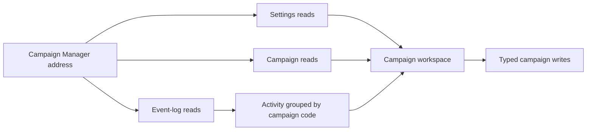

# Campaign Data Access

**Status:** Current

**Last verified:** 2026-09-23

**Scope:** Read Campaign Manager settings, campaigns, and activity; execute campaign writes; and normalize event logs for the Contract
Management campaigns journey.

The user journey remains in [Contract Management](../../features/contract-management/README.md). On-chain authorization and settlement rules
remain in [AdCampaignManager](../../contracts/features/ad-campaign-manager/README.md).

## Consumers

- [Contract Management](../../features/contract-management/README.md) consumes Campaign Manager settings, campaigns, and activity.
- The campaign workspace and configuration forms consume the focused read and write boundaries.

## Runtime Model

## Invariants and Failure Behaviour

- Queries remain disabled until a valid Campaign Manager address is available.
- Campaign detail reads preserve exact integer values and expose empty and failed reads separately.
- Event logs remain grouped by campaign code and retain their chain order within each campaign.
- Click and impression rates are configuration values only; the current runtime does not derive validated spend from them.

## Settings editing boundary

The parent passes the existing typed settings result directly to the rate form; no key/value conversion or parent-owned edit mirror is used.
A form mounts only while the settings panel is open and loaded data exists. Its key includes the selected manager address and chain, so
reopening or changing that identity constructs a fresh local draft of the two rate strings. The read-only Bank address remains on the
settings model.

The draft and confirmed-rate baseline belong to the form. Background refetches update a pristine draft and its baseline without overwriting
active edits; closing discards edits and reopening uses the current query result. Confirming one field advances only its baseline. A
failed/unconfirmed field remains changed and can be retried without resubmitting the confirmed rate. Existing write facades, rate
normalization/validation, 18-decimal amounts and close-after-all-confirmations behavior remain unchanged. This boundary adds no controller
composable, schema framework or reset handshake.

[Compiler settings contracts](../../../app/type-tests/campaign-settings.ts) run in the normal app type gate. They accept the actual read
model and reject missing rates, a missing Bank address and arbitrary key/value arrays. Rendered tests use real parent/form state with
controlled read results and shared chain/mutation mocks; they do not prove live settlement, deployment or off-chain spend authority.

## Known Gaps

- The portal does not independently validate the off-chain click or impression totals used to calculate cumulative campaign spend.

## Implementation Evidence

**Implementation evidence reviewed against:** `a15da820dbc6045c7ddff1da868a9884864397d4`

- [Settings parent](../../../app/src/components/sections/ContractManagementView/TeamContracts.vue),
  [settings form](../../../app/src/components/sections/ContractManagementView/TeamContractsDetail.vue),
  [draft/confirmation tests](../../../app/src/components/sections/ContractManagementView/__tests__/TeamContractDetail.spec.ts), and
  [parent/form lifetime tests](../../../app/src/components/sections/ContractManagementView/__tests__/TeamContracts.spec.ts)
- [Campaign read tests](../../../app/src/composables/campaign/__tests__/reads.spec.ts),
  [campaign write tests](../../../app/src/composables/campaign/__tests__/writes.spec.ts), and
  [campaign event tests](../../../app/src/lib/campaign/__tests__/events.spec.ts)
- [AdCampaignManager contract tests](../../../contract/test/AdCampaignManager.spec.ts)

## Related Documentation

- [Contract Management](../../features/contract-management/README.md)
- [Contract Event Feeds](../contract-event-feeds/README.md)
