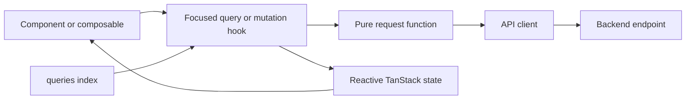

# Client Data Access

**Scope:** Shared client HTTP query and mutation boundaries under `app/src/queries/`, including their central export surface

**Last verified:** 2026-10-01

## Consumers

- Every client feature may consume a focused query or mutation hook.
- [Profile](../../features/user-profile/README.md) uses the single-file upload mutation to prepare a profile image for its user-profile
  update journey.
- Product-specific query owners, such as [Payroll](../../features/payroll/README.md), retain their feature rules and API payload mapping.

## Runtime Model

## Invariants and Failure Behaviour

- A mutation keeps its HTTP request in a pure async function and exposes one focused TanStack mutation hook for callers.
- A caller owns user-visible success callbacks and renders mutation failures reactively in its own context.
- `uploadSingleFile` returns the first uploaded file URL and throws when the backend response does not contain one.
- The `@/queries` barrel re-exports focused query modules; it does not combine their endpoint behaviour or server state.

### Contract-based asset markets

[CoinGecko queries](../../../app/src/queries/coingecko.queries.ts) provide ordinary `useQuery` and `useQueries` observers for
supported-token prices, Polygon contract metadata and historical snapshots. Each query uses the external Axios client to call the configured
CNC backend's public market routes and forwards cancellation, validates contract identity or historical precision through
[pure utilities](../../../app/src/utils/tokens/coingecko.ts), and caches the unchanged valid provider response. The
[Accounting data layer](../../../app/src/composables/accounting/useCNCAccounting.ts) consumes those queries directly and uses the pure
utilities to resolve a token's transaction-date rate. The currency store consumes the price query. Current prices use
`queryPresets.moderate` for one-minute freshness; contract identity and historical snapshots use `queryPresets.once`, without local
`staleTime` overrides. The authenticated CNC query factory is not used for these reads because its HTTP retry interceptor would override the
CoinGecko query retry policy. Provider HTTP, shared Redis caching and cross-instance admission belong to
[Shared Market Data Cache](../market-data-cache/README.md).

Asset market discovery verifies the provider platform and contract address before returning an asset's coin identity, current USD price, or
optional display logo. Contract market lookup supports Polygon (137) only; Hardhat, Amoy, Sepolia, and other networks remain unavailable
without sending a provider request. Test contracts never inherit Polygon prices by address or symbol. Valid HTTPS image URLs come from that
same verified contract response and remain available even when its price is missing. Safe metadata logos survive matching-contract RPC
metadata enrichment. Raw contract metadata is retained for 24 hours after its last observer; historical snapshots remain immutable by
coin/date. Safe transfer history is paginated and deduplicated using the service transfer identity; later-page failures reject the whole
history. The read-only Safe portfolio is independent of CNC payment allowlists.

Incoming deposits retain the service's raw transfer objects. An ERC-20 deposit without `tokenInfo` displays `Token amount unavailable`; the
raw object retains the token contract, transaction hash, and value. Missing metadata does not establish token reputation or identify the
transaction signer. The complete asset-transfer query can recover metadata independently, so holdings and deposits may have different
available metadata.

### Safe provider filtering

The Safe Client Gateway balance request uses `exclude_spam=true&trusted=false`. The frontend displays every returned item and has no local
contract blacklist. Provider symbols or trust flags do not expand CNC's configured payment allowlist.

Transaction Service histories retain every returned movement, including unknown and untrusted contracts, before the existing Accounting
mapping and completeness checks. Metadata recovery uses the event's contract address. There is no client-side spam classification or
quarantine; provider history can include spam-like events, which may reach Accounting or leave explicit metadata and valuation gaps.

Executable evidence: [Gateway request tests](../../../app/src/queries/__tests__/safeClient.queries.spec.ts) and
[pagination and metadata unit tests](../../../app/src/queries/__tests__/safe.queries.spec.ts). These invoke request functions with mocked
provider responses and query dependencies; live browser validation remains pending.

### Browser request coordination

Safe and CoinGecko HTTP requests live in their query modules and use the existing
[external Axios client](../../../app/src/lib/external.axios.ts), including its 15-second timeout and query cancellation signal. Independent
Transaction Service reads run directly through Axios and TanStack Query without a shared admission queue or provider-wide pause. A 429 is
reported by the affected query; unrelated queries keep running, and explicit refresh remains available. The existing Axios client's request
interceptor attaches `VITE_APP_SAFE_API_KEY` only to GET requests under `https://api.safe.global/tx-service/`; its error interceptor removes
authorization headers from propagated diagnostics. Gateway and other providers receive no Safe credential. Direct production URLs avoid
cross-origin redirects. A production key must come from `developer.safe.global`; staging keys from `developer.5afe.dev` do not establish a
production quota. Service writes retain their explicit mutation path. Gateway keeps its own balance query cadence.

CoinGecko requests use standard TanStack cache identities and independent query error states. Queries for the same identity share one
browser request; distinct identities can reach the backend concurrently. The backend shares validated responses, miss leases, provider
admission and 429 cooldown through Redis, as described in [Shared Market Data Cache](../market-data-cache/README.md). All CoinGecko queries
disable automatic retries. Current prices still poll every five minutes; contract discovery and historical snapshots are requested when
needed and unavailable results can be retried by explicit Accounting refresh. During provider cooldown, valid shared cache hits remain
available and uncached reads fail with 429 and the remaining retry window.

Safe information, complete transfer histories, Gateway holdings and current prices inherit the moderate preset's one-minute freshness. Safe
information, histories and current-price observers poll every five minutes; Gateway balances poll every minute. The transaction queue polls
every minute while a pending transaction exists and every five minutes otherwise; a single transaction detail does not poll. Successful
token metadata and verified coin identities use the once preset with 24-hour retention. Transaction Service queries inherit the moderate
preset's two-minute unused-cache retention; Gateway balances and current prices retain unused data for 30 minutes. Successful historical
price snapshots use the once preset, remain fresh without polling, and retain unused cache entries for the lifetime of the query client.
This explicitly disables the shared query client's polling interval for historical reads. Each query inherits freshness and declares its
polling cadence. Periodic observers do not poll in background tabs or refetch on window focus. Transaction Service queries inherit the
Safe-specific bounded retries and also recover on periodic or explicit refresh. Gateway and Transaction Service queries retry temporary 404,
408, 425, 429, server and network failures up to three times. The interval stays fixed at five seconds for ordinary transient failures and
thirty seconds for HTTP 429, and waits longer when the provider's numeric or HTTP-date `Retry-After` requires it. Initial reads remain
pending through recovery, so successful responses update the mounted UI without a reload. Cancellation, other client errors, malformed
responses and an explicit monthly-quota-exceeded response do not retry automatically. CoinGecko and token-metadata reads disable automatic
retries.

Accounting deduplicates contract discovery and coin/date targets, then consumes their independent observers. Missing, malformed or failed
rates remain explicit valuation gaps without a current-price fallback. The existing Accounting refresh retries failed query observers;
dependent historical dates start when verified contract metadata becomes available. Successful snapshots are reused. A disabled valuation
consumer sends no requests, including on refresh. There is no automatic historical polling. Backend admission coordinates CoinGecko reads
across users and instances sharing Redis; it does not guarantee quota for arbitrary numbers of distinct cold snapshots or external clients
using the same provider credential.

`staleTime` describes successful-cache freshness, `refetchInterval` schedules observer refreshes, and `retryDelay` applies only when `retry`
permits another failed request. Successful historical snapshots remain immutable; `retry: false` disables per-request retries. Full Safe
pagination is retained on each history refresh; this change does not implement incremental synchronization. A later-page failure leaves the
previous successful query result in cache and rejects the incomplete replacement.

[Safe Client balance queries](../../../app/src/queries/safeClient.queries.ts) fetch native and ERC-20 holdings, exact base-unit quantities,
token metadata, current unit prices and fiat values in one request to the Safe Client Gateway. The raw Gateway response stays in TanStack
Query; [pure holdings presentation](../../../app/src/utils/safe/portfolio.ts) maps each returned item directly to one typed table row,
preserving metadata, exact quantity, provider order and zero balances. It does not insert, filter or regroup currencies. Zero or missing
prices for nonzero holdings keep values and totals explicitly incomplete, including the Gateway's zero-price fallback. The summary checks
completeness against raw items and reads `fiatTotal` directly, without formatting table rows or recalculating a total from them. The
response contract is defined in [Safe types](../../../app/src/types/safe.ts).

Company and Companies list summaries consume the provider's valued `fiatTotal`, keeping the known valuation even when another holding lacks
a price. The Companies list creates one observer per unique Safe with the same balance options, address, configured chain and selected fiat
currency as Safe Account, so it reuses the existing cache rather than re-reading the Safe through the restricted payment-token RPC batch.
Holdings expose precise price and value details without deriving balances from rounded display labels.

Address, configured chain and uppercase fiat code identify each balance cache entry. The overview and holdings share one USD request; a
selected non-USD currency has its own Gateway request while the overview retains its USD total. No transfer-history, RPC balance or
CoinGecko current-price reads are required to populate these holdings. The query refreshes every minute in active tabs, retains unused data
for 30 minutes, propagates cancellation and uses the bounded recovery described above. Both Gateway and Transaction Service GETs use the
external Axios client directly. A failed request retains its cached response while exposing the error; the UI marks the total incomplete.

[Gateway queries](../../../app/src/queries/safeClient.queries.ts) own the balance HTTP request and reject malformed response bodies.
[Safe movement queries](../../../app/src/queries/safe.queries.ts) retain one local pagination helper shared by the three complete-history
reads. The asset-transfer helper deduplicates stable transfer identities and recovers missing contract metadata through the calling
observer's TanStack client. Concurrent rows for one contract share its metadata query; enriched rows are copied without modifying provider
objects. Failed metadata reads retain the original movement and its completeness diagnostic. Accounting keeps its Transaction Service
movement feeds and historical market snapshots; other account surfaces keep their RPC balances and existing price queries. Gateway discovery
does not expand CNC transfer currencies. Confirmed operations use [one Safe invalidation helper](../../../app/src/queries/safe.mutations.ts)
for the entire Safe service prefix and the affected wallet's balance prefix, which also reaches all Gateway fiat entries. Proposals refresh
only pending transactions until execution. Direct hosted Gateway access is a runtime dependency; mocked query tests do not establish an
availability guarantee.

Executable evidence: [Gateway request tests](../../../app/src/queries/__tests__/safeClient.queries.spec.ts) and
[holdings presentation tests](../../../app/src/utils/safe/__tests__/portfolio.spec.ts).

[Safe recovery tests](../../../app/src/queries/__tests__/safe.recovery.spec.ts) execute the configured queries with a real TanStack cache
and simulated provider responses, verifying recovery without a reload, shared balance reads, retry deadlines and persistent-error
visibility.

Direct Transaction Service reads are covered by [pagination and metadata tests](../../../app/src/queries/__tests__/safe.queries.spec.ts) and
[Axios authentication and cancellation tests](../../../app/src/lib/__tests__/external.axios.spec.ts).

The query unit tests cover request parameters, response validation, pagination and propagated errors. TanStack observers are mocked; these
tests do not establish cache sharing, refresh or observer lifecycle behaviour.

TanStack caches belong to one browser session. The additional backend Redis cache coordinates CoinGecko across users, tabs, devices and
backend instances. Safe provider requests retain their browser-only coordination boundary.

## Implementation Evidence

**Implementation evidence reviewed against:** `8bb7376a908abee0cdd59621ba7ee5cfcc153de6`

- [Query barrel](../../../app/src/queries/index.ts), [query factory](../../../app/src/queries/queryFactory.ts), and
  [single-file upload query](../../../app/src/queries/file.queries.ts)
- [Profile image consumer](../../../app/src/components/forms/ProfileImageUpload.vue) and
  [pure upload/query tests](../../../app/src/queries/__tests__/file.queries.spec.ts)
- [HTTP client tests](../../../app/src/lib/__tests__/axios.spec.ts),
  [CoinGecko endpoint unit tests](../../../app/src/queries/__tests__/coingecko.queries.spec.ts), and
  [Safe pagination and metadata unit tests](../../../app/src/queries/__tests__/safe.queries.spec.ts)
- [Accounting data layer](../../../app/src/composables/accounting/useCNCAccounting.ts) and
  [Accounting composition tests](../../../app/src/composables/accounting/__tests__/useCNCAccounting.spec.ts)

## Related Documentation

- [Query hook conventions](../../../app/src/queries/README.md)
- [Profile](../../features/user-profile/README.md)
- [Vue Component Standards](../../../.github/copilot-instructions/vue-component-standards.md)
- [Documentation Freshness Policy](../../platform/documentation-freshness-policy.md)
