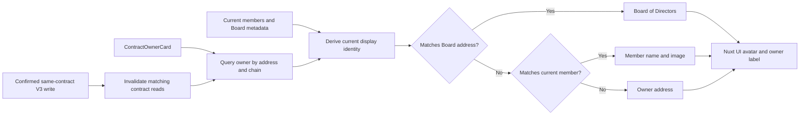

# Contract Owner Resolution — Implementation

**Scope:** Shared client-side resolution and presentation of the current owner for a company contract

**Last verified:** 2026-11-05

This capability resolves the contract's on-chain owner into a Board of Directors, a current company member, or an otherwise unknown address.
Product permissions and contract actions remain owned by their feature documentation.

## Consumers

- [Accounts](../../features/accounts/README.md) presents the current owner of Bank, Expense Account, and Cash Remuneration contracts.
- [Shareholder Management](../../features/shareholder-management/README.md) presents the current Investor owner.
- [Elections](../../features/elections/README.md) presents the Elections contract owner.

## Runtime Model

## Invariants and Failure Behaviour

- The Board address takes precedence over a member lookup when both could identify the same address.
- A known current member retains the member name and image; an unknown owner falls back to the returned address.
- An image-less owner receives the avatar fallback rather than a fabricated profile image.
- The shared `useContractOwner` read uses the existing Ownable ABI and standard wagmi `readContract` cache identity, including reactive
  address and chain. Missing or invalid addresses disable the read and show unavailable rather than permanent loading.
- Identity is a pure projection of the current owner, current members and current Board address. Changing a member name/image, membership or
  Board metadata at a constant contract address updates the presentation without another owner request.
- A new address or chain has its own query state; an older response cannot overwrite that selection or appear as the new contract's owner.
- Initial reads show loading only while fetching. A final failure shows unavailable and a retry action; a failed refresh retains usable
  cached ownership with an explicit warning that it may be outdated. Retry, polling, focus refresh and errors remain query-owned.
- Confirmed same-contract V3 writes invalidate this registered owner query through the existing address predicate, scoped to chain when the
  write pins one. The card adds no imperative invalidation path and does not grant or alter permissions.

The actual wagmi/TanStack owner producer and rendered card tests use a controlled RPC transport, including encoded owner results. They
exercise metadata changes, delayed/missing addresses, error/retry, stale refreshes, old responses, chain identity and a successful V3
ownership transfer followed by owner-query refetch. This frontend proof does not establish live RPC freshness or a real wallet transfer.

## Implementation Evidence

**Implementation evidence reviewed against:** `24c8e67951fb0ac0213105ff7afad413433a7636`

- [Shared Ownable read](../../../app/src/composables/contracts/reads.ts),
  [existing Ownable ABI](../../../app/src/artifacts/abi/ownable-pausable.ts), and
  [standard invalidation predicate](../../../app/src/composables/contracts/useContractWritesV3.ts)
- [Pure owner identity projection](../../../app/src/utils/contracts/presentation.ts) and
  [presentation tests](../../../app/src/utils/contracts/__tests__/presentation.spec.ts)
- [Shared owner-resolution card](../../../app/src/components/ui/ContractOwnerCard.vue)
- [Owner-resolution component tests](../../../app/src/components/ui/__tests__/ContractOwnerCard.spec.ts)

## Related Documentation

- [Accounts user journeys](../../features/accounts/README.md)
- [Shareholder Management user journeys](../../features/shareholder-management/README.md)
- [Implementation Documentation Guide](../../platform/implementation-documentation-guide.md)
