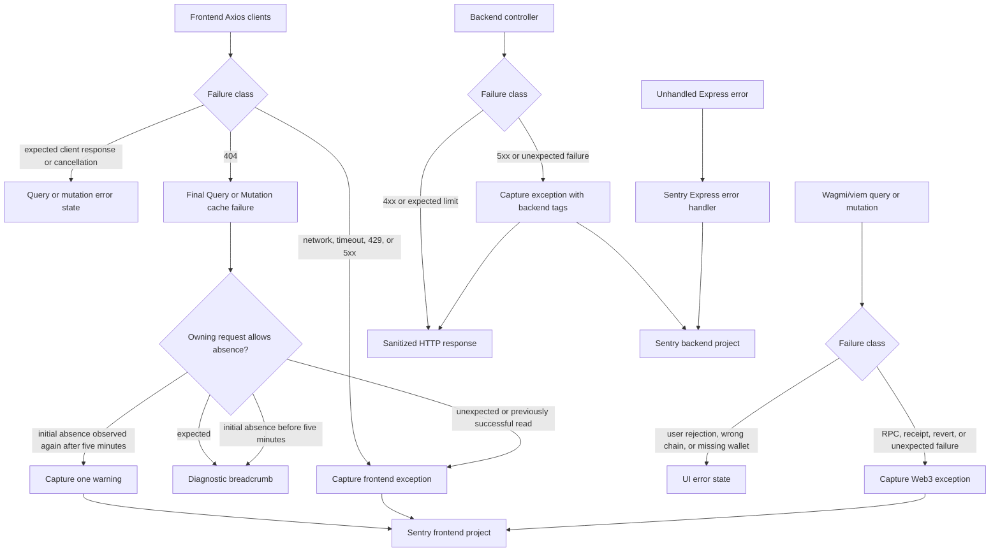

# Error Tracking

**Status:** Current

**Last verified:** 2026-11-01

**Scope:** Capture actionable frontend and backend failures in Sentry while keeping expected client responses and cancellations out of
exception tracking.

## Consumers

- Backend API controllers and shared HTTP error responses
- Frontend and dashboard consumers of backend API failures
- Sentry backend project and its configured deployment environments

## Runtime Model

## Main Flow

Controllers that use `errorResponse()` report failures with a status of `500` or greater before returning the sanitized response.
Controllers with dedicated `5xx` response paths call the same capture helper directly. CoinGecko captures provider and cache failures with
the operation and HTTP status as tags. The Sentry SDK environment is configured at process startup, and the Express Sentry handler remains
the fallback for errors that are not handled by a controller.

The frontend's internal API client and external provider client share the Axios capture helper. Internal API retries are allowed to finish
before one final failure is captured, while external provider failures are captured at the response interceptor. Vue's global error
instrumentation remains responsible for uncaught JavaScript, promise, and Vue component failures. The shared TanStack Query and Mutation
caches capture handled Wagmi/viem failures from reads and mutations; the MutationCache remains a fallback for mutations without a
specialized Web3 boundary. Contract-write and native-transfer mutations mark their boundaries so their handlers capture once with operation,
contract, function, and chain tags before the generic fallback can run.

### Handled HTTP 404 responses

The shared QueryCache and MutationCache classify an Axios 404 only after the query or mutation exhausts its configured retries. Axios
interceptors leave these responses for that lifecycle rather than reporting every request attempt. Every required read or mutation is
unexpected by default. The request that owns an allowed absence opts in through Axios `sentryNotFound`; query-factory reads expose this as
`notFound`:

- `expected`: missing-company detail and missing-profile reads, including the profile step inside sign-in, remain diagnostic states. A
  missing sign-in nonce, collection endpoint, write endpoint or other unclassified resource remains unexpected.
- `initially-expected`: Safe Transaction Service and Gateway reads allow initial indexing absence. A 404 after that same query has already
  stored a successful response is an error. Without successful cached data, an absence observed again at least five minutes after its first
  final 404 produces one warning. This is a persistence signal, not proof of failed indexing or a missing on-chain contract.

The first 404 adds an informational `http.not_found` breadcrumb with operation, query family, method and expectation. Breadcrumbs accompany
later events; they are not independent persisted logs or issues. Unexpected 404 events carry frontend runtime, Axios source, operation,
query-family, method, HTTP status and classification tags, with authorization headers removed. Original Axios errors still reach consumers,
and successful cached data is retained.

Each query cache entry emits at most one event during a continuous absence. A successful fetch resets the reporting state, allowing a new
outage to be reported; other query entries remain independent. Mutation retries produce one final report per mutation invocation. This
telemetry state uses weak references to cache boundaries and lasts only while those boundaries remain in memory. It adds no timer, polling,
retry or request: a stopped Safe balance query requires an existing explicit or observer-triggered refresh to observe persistent absence.

## Invariants and Failure Behaviour

- Client errors (`4xx`) are not captured as backend exceptions.
- Expected provider rate limits and health-check dependency failures are not reported as repeated exceptions.
- Backend `5xx` events carry the `runtime:backend` tag and the configured Sentry environment.
- Frontend Axios events carry the `runtime:frontend`, `error.source`, `error.operation`, and HTTP status tags.
- Frontend network failures, timeouts, `429`, and `5xx` responses retain their interceptor capture policy. Expected `401` responses and
  cancellations remain outside exception capture; handled `404` responses follow the contextual policy above.
- Wagmi/viem RPC failures, receipt failures, transaction reverts, and unexpected Web3 errors are captured with `runtime:frontend`,
  `error.source:wagmi`, operation, and error-category tags.
- Specialized contract-write and native-transfer boundaries take capture priority over the shared MutationCache, preserving their Web3
  context without removing the original TanStack mutation error.
- Explicit wallet rejections, wrong-chain states, disconnected accounts, and missing wallet providers remain UI states and are not captured
  as Sentry exceptions.
- Authorization headers are removed before Axios errors are sent to Sentry.
- Capture helpers add operation, source, status, method, query-family and classification context only; they do not add request payloads,
  credentials or provider connection details.
- Sentry tunnel forwarding failures remain silent so telemetry cannot break the application or recursively report its own outage.

## Known Gaps

The tunnel deliberately acknowledges forwarding failures, so a successful browser request to the tunnel does not by itself prove that Sentry
accepted the event. The Sentry dashboard and a controlled smoke test remain required for end-to-end ingestion validation.

The handled-404 policy applies to operations using the application's shared QueryClient. Standalone Axios calls outside that lifecycle do
not gain this classification. A page reload or query garbage collection also ends its absence history; the five-minute threshold is not a
durable service-level monitor. Trace sampling is unchanged and does not decide whether the explicit exception capture runs.

Shared transaction boundaries retain the configured application chain. A rejected network target uses the existing chain-mismatch
classification, so it remains an expected wallet condition rather than an unexpected application failure. Session recovery is owned by the
[Authentication network-lock story](../../features/authentication/README.md#us-auth-004-resume-after-a-wallet-network-change).

## Implementation Evidence

**Implementation evidence reviewed against:** `f15dccbe52468b554ce87b92f5db48411b921bb9`

- [Backend capture helper](../../../backend/src/utils/sentry.ts), [central error response](../../../backend/src/utils/utils.ts), and
  [Sentry initialization](../../../backend/src/instrument.ts)
- [Frontend Axios capture helper](../../../app/src/lib/sentry.ts), [internal API client](../../../app/src/lib/axios.ts), and
  [external API client](../../../app/src/lib/external.axios.ts)
- [Frontend Web3 capture helper](../../../app/src/lib/sentry.ts), [shared Query/Mutation caches](../../../app/src/queries/queryClient.ts),
  [contract-write mutation](../../../app/src/composables/contracts/useContractWritesV3.ts), and
  [native-transfer mutation](../../../app/src/composables/transactions/useSafeSendTransaction.ts)
- [Express Sentry handler registration](../../../backend/src/config/serverConfig.ts)
- [CoinGecko controller](../../../backend/src/controllers/coingeckoController.ts),
  [storage controller](../../../backend/src/controllers/storageController.ts),
  [upload controller](../../../backend/src/controllers/uploadController.ts), and
  [development controller](../../../backend/src/controllers/devController.ts)
- [Capture and response tests](../../../backend/src/utils/__tests__/utils.test.ts) and
  [tunnel tests](../../../backend/src/routes/__tests__/sentryTunnelRoute.test.ts)
- [Frontend Axios capture tests](../../../app/src/lib/__tests__/axios.spec.ts) and
  [external Axios capture tests](../../../app/src/lib/__tests__/external.axios.spec.ts)
- [Frontend Web3 capture tests](../../../app/src/lib/__tests__/sentry.spec.ts)
- [Handled HTTP 404 lifecycle and real Axios-adapter tests](../../../app/src/queries/__tests__/queryClient.notFound.spec.ts),
  [query-factory request policy](../../../app/src/queries/queryFactory.ts), [company reads](../../../app/src/queries/team.queries.ts),
  [profile reads](../../../app/src/queries/user.queries.ts), [sign-in profile request](../../../app/src/api/user.api.ts),
  [Safe Transaction Service requests](../../../app/src/queries/safe.api.ts), and
  [Safe Gateway requests](../../../app/src/queries/safeClient.queries.ts)
- [Shared mutation-cache capture tests](../../../app/src/queries/__tests__/queryClient.spec.ts),
  [contract-write boundary tests](../../../app/src/composables/contracts/__tests__/useContractWritesV3.spec.ts), and
  [native-transfer boundary tests](../../../app/src/composables/transactions/__tests__/useSafeSendTransaction.spec.ts)

## Related Documentation

- [Deployment and Sentry environment configuration](../../platform/deployment.md#error-tracking)
- [Shared Market Data Cache](../market-data-cache/README.md)
- [File Storage](../file-storage/README.md)
- [Implementation Documentation Guide](../../platform/implementation-documentation-guide.md)
