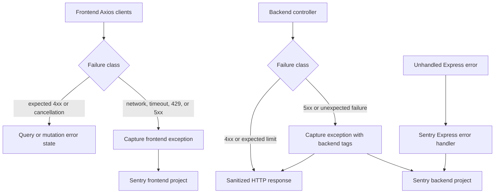

# Error Tracking

**Status:** Current

**Last verified:** 2026-10-20

**Scope:** Capture actionable frontend and backend failures in Sentry while keeping expected client responses and cancellations out of
exception tracking.

## Consumers

- Backend API controllers and shared HTTP error responses
- Frontend and dashboard consumers of backend API failures
- Sentry backend project and its configured deployment environments

## Runtime Model

## Main Flow

Controllers that use `errorResponse()` report failures with a status of `500` or greater before returning the sanitized response.
Controllers with dedicated `5xx` response paths call the same capture helper directly. CoinGecko captures provider and cache failures with
the operation and HTTP status as tags. The Sentry SDK environment is configured at process startup, and the Express Sentry handler remains
the fallback for errors that are not handled by a controller.

The frontend's internal API client and external provider client share the Axios capture helper. Internal API retries are allowed to finish
before one final failure is captured, while external provider failures are captured at the response interceptor. Vue's global error
instrumentation remains responsible for uncaught JavaScript, promise, and Vue component failures.

## Invariants and Failure Behaviour

- Client errors (`4xx`) are not captured as backend exceptions.
- Expected provider rate limits and health-check dependency failures are not reported as repeated exceptions.
- Backend `5xx` events carry the `runtime:backend` tag and the configured Sentry environment.
- Frontend Axios events carry the `runtime:frontend`, `error.source`, `error.operation`, and HTTP status tags.
- Frontend network failures, timeouts, `429`, and `5xx` responses are captured; expected `401`/`404` responses and cancellations are not.
- Authorization headers are removed before Axios errors are sent to Sentry.
- Capture context contains operation, source, and status tags only; request payloads, credentials, and provider connection details are not
  added by the capture helper.
- Sentry tunnel forwarding failures remain silent so telemetry cannot break the application or recursively report its own outage.

## Known Gaps

The tunnel deliberately acknowledges forwarding failures, so a successful browser request to the tunnel does not by itself prove that Sentry
accepted the event. The Sentry dashboard and a controlled smoke test remain required for end-to-end ingestion validation.

## Implementation Evidence

**Implementation evidence reviewed against:** `95d9e12dd696864913e37ad6e20222587b223591`

- [Backend capture helper](../../../backend/src/utils/sentry.ts), [central error response](../../../backend/src/utils/utils.ts), and
  [Sentry initialization](../../../backend/src/instrument.ts)
- [Frontend Axios capture helper](../../../app/src/lib/sentry.ts), [internal API client](../../../app/src/lib/axios.ts), and
  [external API client](../../../app/src/lib/external.axios.ts)
- [Express Sentry handler registration](../../../backend/src/config/serverConfig.ts)
- [CoinGecko controller](../../../backend/src/controllers/coingeckoController.ts),
  [storage controller](../../../backend/src/controllers/storageController.ts),
  [upload controller](../../../backend/src/controllers/uploadController.ts), and
  [development controller](../../../backend/src/controllers/devController.ts)
- [Capture and response tests](../../../backend/src/utils/__tests__/utils.test.ts) and
  [tunnel tests](../../../backend/src/routes/__tests__/sentryTunnelRoute.test.ts)
- [Frontend Axios capture tests](../../../app/src/lib/__tests__/axios.spec.ts) and
  [external Axios capture tests](../../../app/src/lib/__tests__/external.axios.spec.ts)

## Related Documentation

- [Deployment and Sentry environment configuration](../../platform/deployment.md#error-tracking)
- [Shared Market Data Cache](../market-data-cache/README.md)
- [File Storage](../file-storage/README.md)
- [Implementation Documentation Guide](../../platform/implementation-documentation-guide.md)
