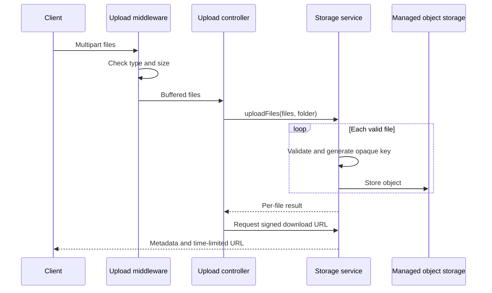

# File Storage

**Status:** Current

**Last verified:** 2026-10-21

**Scope:** Own the backend boundary for validating uploads, storing file objects, issuing time-limited download URLs, and refreshing or
deleting persisted attachment references. This capability does not own the product rules that decide when a profile image or claim
attachment may be changed.

## Consumers

- [User Profile](../../features/user-profile/README.md)
- [Payroll](../../features/payroll/README.md)
- Backend upload and storage routes

## Runtime Model

| Component          | Responsibility                                                                                   |
| ------------------ | ------------------------------------------------------------------------------------------------ |
| Upload middleware  | Buffers accepted files in memory and rejects unsupported MIME types or oversized files           |
| Upload controller  | Sends the request's file collection through the public batch-upload boundary                     |
| Storage service    | Validates each file, generates an opaque key, stores it, signs downloads, and deletes objects    |
| Attachment service | Refreshes stored URLs and performs best-effort cleanup without discarding legacy attachment data |

The single-file validation and upload steps are implementation details of `uploadFiles`. Tests exercise them through the public batch
boundary rather than expanding the production export surface.

## Main Flow

## Invariants and Failure Behaviour

- At most ten valid files are accepted by one `uploadFiles` call, and each file is checked against the shared type and size limits.
- Stored metadata contains the generated object key, MIME type, and size; the original filename is not used as the stored key.
- The upload controller rejects file uploads with `Storage not configured` before calling the storage service when required storage
  credentials are unavailable.
- A storage upload failure becomes a per-file failure result rather than an unhandled exception.
- Unexpected upload and presigned-URL controller failures that return `5xx` are captured by the backend error-tracking capability without
  adding file contents or credentials to the event.
- A failed attachment URL refresh preserves the original attachment entry.
- Attachment cleanup accepts legacy entries with only a non-empty object key and continues when an individual delete fails.
- Download URLs are time-limited and are generated from stored object keys.

## Client attachment URL renewal

Persisted claim previews retain the stored key through editing and modal selection. Both attachment galleries resolve keyed files through
`getPresignedUrl` at list load, opening and downloading, including when an incoming preview already has a URL. That helper alone owns the
existing 50-minute reuse policy. Gallery results are rendering state, not another validity cache. Local files without keys use their local
URLs without a signing request.

After expiry, opening or downloading renews the URL without requiring a prop change or remount. A failed renewal shows retryable feedback
and never falls back to an old signed URL. Removal, list replacement, closing and unmounting prevent obsolete asynchronous results from
restoring a selection or older display list. Selection follows the file key rather than a changing URL.

Downloads reserve a blank window synchronously during the click, detach its opener, then navigate through a link with `noopener noreferrer`
after resolution. Failure or removal closes the reserved window; blocked popups produce actionable feedback. Thumbnail URLs are resolved on
load/list changes; continuous background renewal is not promised. Storage authorization, upload/deletion and URL-expiry policy are
unchanged.

## Known Gaps

- Attachment deletion is best-effort. A failed delete is logged, but there is no persisted retry queue or failure status for callers.

## Implementation Evidence

**Implementation evidence reviewed against:** `6a1619cd9446cad807bd019e34877639af6a6e72`

- [Upload route](../../../backend/src/routes/uploadRoute.ts) and [upload controller](../../../backend/src/controllers/uploadController.ts)
- [Upload middleware](../../../backend/src/utils/upload.ts) and [middleware tests](../../../backend/src/utils/__tests__/upload.test.ts)
- [Storage service](../../../backend/src/services/storageService.ts) and
  [storage tests](../../../backend/src/services/__tests__/storageService.test.ts)
- [Attachment service](../../../backend/src/services/attachmentService.ts) and
  [attachment tests](../../../backend/src/services/__tests__/attachmentService.test.ts)
- [Upload route tests](../../../backend/src/routes/__tests__/uploadRoute.test.ts)
- [Client upload API](../../../app/src/api/upload.api.ts), [upload API tests](../../../app/src/api/__tests__/upload.api.spec.ts),
  [storage API tests](../../../app/src/api/__tests__/storage.api.spec.ts), and
  [file-query tests](../../../app/src/queries/__tests__/file.queries.spec.ts)
- [Shared client upload validation](../../../app/src/types/upload.ts) and
  [client upload validation tests](../../../app/src/types/__tests__/upload.spec.ts)
- [Expandable attachment-gallery tests](../../../app/src/components/sections/CashRemunerationView/Form/__tests__/ExpandableFileGallery.spec.ts)
  and [file-preview gallery tests](../../../app/src/components/sections/CashRemunerationView/Form/__tests__/FilePreviewGallery.spec.ts)
- [Gallery state and URL actions](../../../app/src/composables/useFilePreviewGallery.ts),
  [standard gallery](../../../app/src/components/sections/CashRemunerationView/Form/FilePreviewGallery.vue),
  [expandable gallery](../../../app/src/components/sections/CashRemunerationView/Form/ExpandableFileGallery.vue), and
  [actual gallery/URL lifecycle tests](../../../app/src/components/sections/CashRemunerationView/Form/__tests__/FilePreviewGallery.lifecycle.spec.ts)
- [Claim preview producer](../../../app/src/utils/claims/form.ts) and [producer tests](../../../app/src/utils/claims/__tests__/form.spec.ts)
- [Presigned file URL composable](../../../app/src/composables/useFileUrl.ts),
  [file URL tests](../../../app/src/composables/__tests__/useFileUrl.spec.ts), and
  [profile-image URL utility tests](../../../backend/src/utils/__tests__/profileImage.util.test.ts)

## Related Documentation

- [Request Validation](../request-validation/README.md)
- [User Profile](../../features/user-profile/README.md)
- [Payroll](../../features/payroll/README.md)
- [Architectural Capability Inventory](../README.md)
