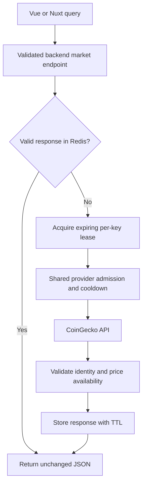

# Shared Market Data Cache

**Scope:** Backend CoinGecko reads shared by the Vue client and Nuxt dashboard through Redis

**Last verified:** 2026-10-13

## Consumers

- [Client Data Access](../client-data-access/README.md) supplies supported-token prices, Polygon contract metadata and dated snapshots to
  the client currency store and [Accounting](../../features/accounting/README.md).
- [Statistics](../../features/backoffice/statistics/README.md) uses dashboard token prices for valuation.

## Runtime Model

## Main Flow

The public backend routes preserve market reads used before login. Input validation accepts only coin IDs, Polygon addresses, ISO calendar
dates and a bounded list of simple-price IDs in USD; callers cannot select an upstream host or arbitrary query parameters. Simple-price IDs
are lowercased, deduplicated and sorted before cache lookup. The backend chooses the fixed CoinGecko Demo or Pro origin and sends the
optional API key in the corresponding provider header.

Redis stores validated provider JSON without rounding or changing the response shape. Current coin responses and simple prices expire after
60 seconds, Polygon contract metadata after 24 hours, and historical coin/date snapshots after 30 days. Demo and Pro namespaces are
separate. Invalid cached JSON is replaced through the locked miss path.

An expiring per-key lease coordinates concurrent misses across backend instances. Waiting callers reuse the filled entry; only the lease
owner may release its lock. Redis also atomically checks the shared cooldown and admits provider requests at a configured minimum interval,
2100 milliseconds by default. This interval limits request starts across instances using the same Redis database and namespace; other
applications using the provider key or IP are outside its boundary. Contended callers have a 12-second service budget and receive 503 with a
retry window when admission or a lease remains unavailable. Provider requests have an eight-second timeout within that budget. A browser
cancellation stops its client observer; the shared backend read may still finish and populate Redis for other callers.

## Invariants and Failure Behaviour

- Provider data is accepted only for the requested coin identity or exact Polygon contract. Missing historical USD rates remain failures;
  the service never substitutes today's price. Simple prices must include a valid positive USD value for each requested ID.
- Provider 429 responses extend a shared cooldown by at least one minute, respecting a longer seconds or HTTP-date `Retry-After`. Cache hits
  remain available during cooldown; misses return 429 and the remaining retry window without calling CoinGecko.
- Provider 404 remains 404. Other provider HTTP or transport errors return sanitized 502 responses. Invalid JSON, identity mismatches and
  missing required prices are not stored as successful data.
- Missing, unreachable or failed Redis returns sanitized 503; the backend does not bypass the cache and flood CoinGecko. Redis connection
  and command waits are bounded, offline command buffering is disabled, and later requests may reconnect.
- The public route has a per-process, per-IP limit of 120 requests per minute. Shared provider admission remains independent of this local
  HTTP limit. Responses use `Cache-Control: no-store`; Redis and the existing frontend query cache own freshness.
- CoinGecko credentials and Redis connection details stay in backend environment variables. They are never returned in market responses or
  logged by the market services.

## Configuration

Set `REDIS_URL` to the managed Redis connection URL. Configure `COINGECKO_API_KEY` server-side and `COINGECKO_API_PLAN` as `demo` or `pro`;
the default is `demo`. `COINGECKO_REQUEST_INTERVAL_MS` sets the shared start interval, with a 2100-ms default and a 100-ms minimum. Choose
an interval appropriate to the provider quota and other clients sharing it. The Vue client uses its existing backend URL, and the dashboard
uses `NUXT_PUBLIC_BACKEND_URL`. Deploy the backend routes and configure Redis before deploying the frontend consumers.

The environment variable contract is listed in [the backend example](../../../backend/.env.example). A managed Redis instance is an external
runtime dependency; this change does not provision production infrastructure or alter database schema.

## Known Gaps

The automated service tests simulate Redis expiration and atomic operations and mock CoinGecko HTTP responses. They verify cache reuse,
concurrent misses, admission, cooldown, identity, precision and failures, but do not establish a live Redis, provider or browser deployment
guarantee. Real Redis integration and configured production journeys remain to be verified. This cache does not guarantee sufficient
provider quota for an arbitrary number of distinct uncached historical dates; explicit Accounting refresh can retry failed dates.

## Implementation Evidence

**Implementation evidence reviewed against:** `8bb7376a908abee0cdd59621ba7ee5cfcc153de6`

- [Market route](../../../backend/src/routes/coingeckoRoute.ts), [controller](../../../backend/src/controllers/coingeckoController.ts), and
  [request validation](../../../backend/src/validation/schemas/coingecko.ts)
- [Shared cache and provider service](../../../backend/src/services/coingeckoService.ts),
  [Redis connection](../../../backend/src/services/marketRedisService.ts), and
  [route registration](../../../backend/src/config/serverConfig.ts)
- [Client CoinGecko queries](../../../app/src/queries/coingecko.queries.ts) and
  [dashboard price adapter](../../../dashboard/app/api/coingecko.ts)
- [Cache and concurrency tests](../../../backend/src/services/__tests__/coingeckoService.test.ts),
  [HTTP boundary tests](../../../backend/src/routes/__tests__/coingeckoRoute.test.ts), and
  [client request tests](../../../app/src/queries/__tests__/coingecko.queries.spec.ts)

## Related Documentation

- [Architectural capability inventory](../README.md)
- [Client query conventions](../../../app/src/queries/README.md)
- [CoinGecko historical API](https://docs.coingecko.com/reference/coins-id-history)
- [Redis Node.js client](https://github.com/redis/node-redis)
- [Documentation Freshness Policy](../../platform/documentation-freshness-policy.md)
