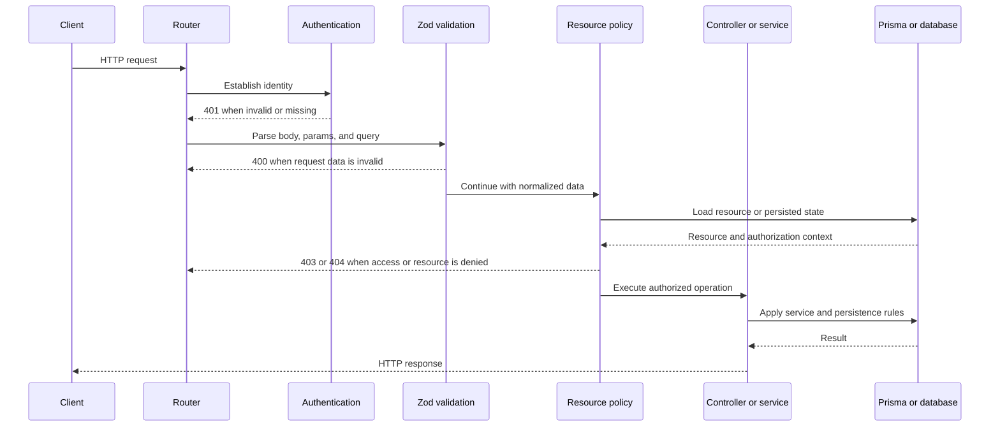
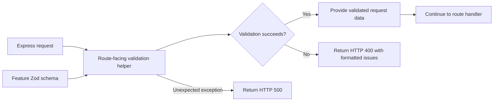

# Request Validation

**Status:** Current

**Last verified:** 2026-11-24

**Implementation evidence reviewed against:** `d37f1c8d64bcfed66cac89353b60a4ec1c2c9a92`

**Scope:** Own the backend request pipeline for input parsing and normalization. Authentication, resource loading and persisted
authorization are separate shared capabilities.

## Consumers

- Backend API routes
- [Authentication](../../features/authentication/README.md)
- [User Profile](../../features/user-profile/README.md)
- [Payroll](../../features/payroll/README.md)
- [Accounting](../../features/accounting/README.md)
- [Accounts](../../features/accounts/README.md)

## Runtime Model

| Component                  | Responsibility                                                                    |
| -------------------------- | --------------------------------------------------------------------------------- |
| Feature schema             | Defines accepted values, coercions, defaults, and field-level business rules      |
| Focused middleware helper  | Selects the request sections required by a route                                  |
| Internal validator         | Parses selected sections and formats failures                                     |
| Combined request validator | Parses `{ params, query, body }` together when rules cross request-section bounds |

Only route-facing helpers are exported. The generic validator remains private so tests and consumers use the same boundaries as production
routes.

The complete route pipeline is:

## Responsibility Boundaries

| Layer                         | Owns                                                                | Does not own                                   |
| ----------------------------- | ------------------------------------------------------------------- | ---------------------------------------------- |
| Zod schemas and middleware    | Presence, types, formats, ranges, enums, coercion and normalization | Authentication or persisted permissions        |
| Authentication middleware     | JWT or session identity                                             | Team or resource authorization                 |
| Loading and policy middleware | Resource existence and database-backed access                       | Feature-specific input shape                   |
| Controller                    | Express orchestration and HTTP translation                          | Reusable domain rules that belong in a service |
| Service                       | Reusable workflow and business operations                           | HTTP status construction                       |
| Prisma and database           | Atomic persistence and final integrity constraints                  | Incoming request formatting                    |

For route composition, read the route from top to bottom. A route should normally apply authentication, Zod validation, resource loading,
and authorization before invoking its handler. Zod may only express rules that it can evaluate from the request sections supplied to it.

Rules that require Prisma or another persisted state belong in authorization middleware or a service. Examples include team membership, team
ownership, archived teams, role permissions, resource existence and workflow transitions.

Validated body and path values replace `req.body` and `req.params`. Parsed query values are stored in `res.locals.validatedQuery` because
Express query objects are not rewritten by the middleware. A downstream handler must use these normalized values rather than reparsing the
raw input.

When fields in the body, params and query depend on each other, use `validateRequest`; otherwise use the smallest focused validator. The
route should not perform the same structural validation again in its controller.

## Main Flow

## Invariants and Failure Behaviour

- Route handlers receive parsed body and path values through the request and parsed query values through `res.locals.validatedQuery`.
  Schemas define whether an absent request body is accepted and which defaults apply.
- Invalid body, query, or path data returns HTTP 400 and does not invoke the next handler.
- Cross-section rules use `validateRequest`; independent sections use the smallest focused helper needed by the route.
- Unexpected validator exceptions are logged and converted to HTTP 500 responses.
- Tests exercise the exported route-facing helpers rather than exporting internal factories for test access.
- Database-backed rejection is not input validation: missing resources and unauthorized access must be decided by their owning policy or
  service.
- Authentication failures return 401. Insufficient role or resource permissions return 403. Missing resources return 404. Invalid state
  transitions may return 409 when their policy has a current state that cannot accept the operation.

## Known Gaps

- Validation failures are returned as one formatted message; the API does not expose a structured per-field error payload.

## Implementation Evidence

- [Validation middleware](../../../backend/src/validation/middleware/validate.ts) and
  [middleware tests](../../../backend/src/validation/middleware/__tests__/validate.test.ts) and
  [HTTP query regression tests](../../../backend/src/validation/middleware/__tests__/express5-query.test.ts)
- [Validation registry](../../../backend/src/validation/index.ts)
- [Representative user schema](../../../backend/src/validation/schemas/user.ts) and
  [user-schema tests](../../../backend/src/validation/schemas/__tests__/user.test.ts)
- [Representative claim schema](../../../backend/src/validation/schemas/claim.ts) and
  [claim-schema tests](../../../backend/src/validation/__tests__/claim.test.ts)
- [Expense schemas](../../../backend/src/validation/schemas/expense.ts) and
  [expense-schema tests](../../../backend/src/validation/schemas/__tests__/expense.test.ts)
- [Authentication middleware](../../../backend/src/middleware/authMiddleware.ts)
- [RBAC middleware](../../../backend/src/middleware/roleMiddleware.ts) and [RBAC implementation](../rbac/README.md)
- [Team authorization middleware](../../../backend/src/middleware/teamAuthzMiddleware.ts)
- [Representative expense route](../../../backend/src/routes/expenseRoute.ts)

## Related Documentation

- [Backend Zod validation guide](../../../backend/docs/zod-validation-guide.md)
- [File Storage](../file-storage/README.md)
- [Architectural Capability Inventory](../README.md)
