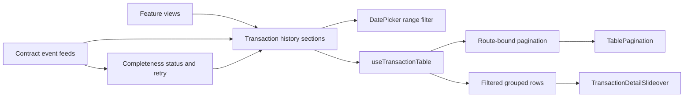

# Transaction History

**Scope:** Shared client-side filtering, pagination, and transaction-detail presentation for account, credit, and shareholder histories.

**Last verified:** 2026-10-21

## Consumers

- [Accounts](../../features/accounts/README.md) uses Bank, Expense Account, and Cash Remuneration transaction histories.
- [Community Credit](../../features/community-credit/README.md) uses the Credit Account transaction history.
- [Shareholder Management](../../features/shareholder-management/README.md) uses investor transaction history.
- [Payment Gate](../../features/payment-gate/README.md) reuses the transaction-detail slide-over for payment history.
- [Elections](../../features/elections/README.md) reuses the route-bound pagination and pager for the past-election archive.

## Runtime Model

## Invariants and Failure Behaviour

- History sections retain ownership of their query data; `useTransactionTable` only derives filtered, grouped, and paginated rows.
- Contract activity reaches history sections through the shared RPC-log feeds; table filtering does not choose or replace that source.
- Bank, Cash Remuneration, and Credit history sections consume the feed's `gaps` and `timestampGaps` alongside query errors. They show an
  explicit incomplete or unavailable state and expose a scoped retry action instead of treating missing events as an empty history.
- A partial feed keeps the successfully loaded rows visible while warning that the displayed history may be incomplete. A refresh failure
  with cached rows does not erase those rows.
- History sections bind the shared `DatePicker` directly to a `{ start, end } | undefined` range. Their stable storage keys and date-filter
  test selectors are retained.
- The `All time` preset bypasses date filtering instead of imposing an end-of-browser-day cutoff. This keeps the full ledger visible when a
  chain timestamp is ahead of the client clock.
- Page and page size live in the route query, so a paginated view is shareable and survives a reload; several paginated lists can share one
  route under distinct query keys.
- The pager offers only the page sizes its owner allows; a list held in memory that shrinks below the page the URL names falls back to its
  last remaining page rather than showing an empty one.
- A date or type-filter change resets the page and collapses expanded rows without reacting to query refreshes.
- A selected row opens its detail in `TransactionDetailSlideover`; closing it does not alter the applied filters.
- Date-range selection is documented by the [Date Picker capability](../date-picker/README.md).

## Implementation Evidence

**Implementation evidence reviewed against:** `e7a2bedd81eef36d7c1c7ff14910680358638157`

- [Shared table state](../../../app/src/composables/transactions/useTransactionTable.ts)
- [Shared table-state tests](../../../app/src/composables/transactions/__tests__/useTransactionTable.spec.ts)
- [Route-bound pagination state](../../../app/src/composables/usePagination.ts) and its
  [tests](../../../app/src/composables/__tests__/usePagination.spec.ts)
- [Shared pager control](../../../app/src/components/ui/TablePagination.vue)
- [Bank history](../../../app/src/components/sections/BankView/BankTransactions.vue),
  [Expense Account history](../../../app/src/components/sections/ExpenseAccountView/ExpenseTransactions.vue), and
  [Cash Remuneration history](../../../app/src/components/sections/CashRemunerationView/CashRemunerationTransactions.vue)
- [Credit Account history](../../../app/src/components/sections/CommunityCreditView/CreditAccountTransactions.vue) and
  [investor history](../../../app/src/components/sections/SherTokenView/InvestorsTransactions.vue)
- [Transaction history availability alert](../../../app/src/components/sections/TransactionHistoryStatusAlert.vue)
- [Bank, Cash Remuneration, and Credit history tests](../../../app/src/components/sections/BankView/__tests__/BankTransactions.spec.ts),
  [Cash Remuneration tests](../../../app/src/components/sections/CashRemunerationView/__tests__/CashRemunerationTransactions.spec.ts), and
  [Credit history tests](../../../app/src/components/sections/CommunityCreditView/__tests__/CreditAccountTransactions.spec.ts)
- [Investor history integration tests](../../../app/src/components/sections/SherTokenView/__tests__/InvestorsTransaction.spec.ts) and
  [investor history fallback tests](../../../app/src/components/sections/SherTokenView/__tests__/InvestorsTransaction.advanced.spec.ts)
- [Shared transaction detail slide-over](../../../app/src/components/ui/TransactionDetailSlideover.vue)
- [Inline transaction-state tests](../../../app/src/composables/transactions/__tests__/useTransactionInline.spec.ts)

## Related Documentation

- [Date Picker](../date-picker/README.md)
- [Contract Event Feeds](../contract-event-feeds/README.md)
- [Client Navigation](../client-navigation/README.md)
